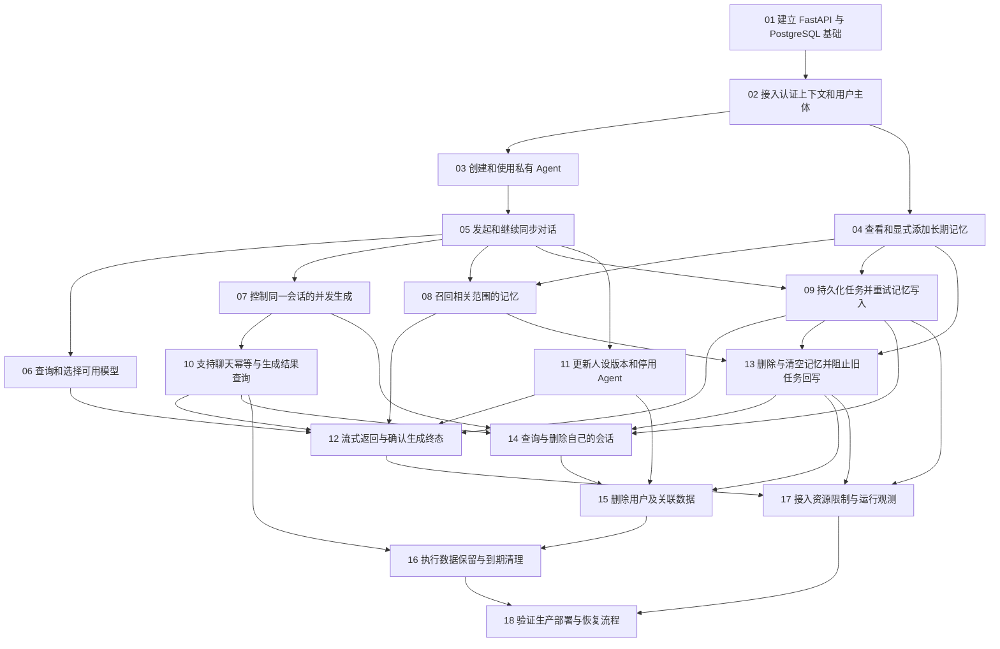

# 带记忆和可配置人设的 AI 对话 API

Status: ready-for-agent

## Problem Statement

用户需要构建一个可复用的 AI 对话后端和 API。系统需要让 Agent 在多次对话之间保留用户记忆，同时允许替换模型、记忆实现和人设，而不改写对话流程。

当前仓库已有架构设计、术语表和架构决策记录，尚无应用代码、数据库迁移或自动化测试。系统还需要在首版保持部署简单，并为未来将记忆或人设独立成服务留下清晰接缝。

## Solution

实现一个模块化单体的 AI 对话后端。对话流程由 Conversation Core 负责，模型、记忆和人设分别通过稳定的提供方接口接入。

首版使用 PostgreSQL 保存应用主数据，使用 MemOS 作为可替换的长期记忆实现。应用保存完整的用户消息和 Agent 消息，长期记忆作为从完整对话回合或用户明确指令中产生的派生数据。

首版提供非流式和流式聊天、用户和会话记忆、私有 Agent 及人设版本化、服务端模型选择、聊天幂等和生成查询、记忆清空屏障、会话与用户删除、数据保留和最小生产运行能力。API 与 Worker 独立运行，均复用模块化单体内的业务接口。Cordis 保留为后续装配能力。未来只有在需要运行时插件加载和卸载、插件依赖管理、第三方插件生态或多 Agent 组合时，才将 Cordis 引入装配层。

## User Stories

1. As a user, I want to send a message to an Agent, so that I can receive an AI-generated response through a stable API.

2. As a user, I want to continue an existing conversation by reusing its conversation ID, so that the Agent can preserve the context of that conversation.

3. As a user, I want the system to identify me through a stable authenticated user ID, so that my conversations, memories and Agents remain isolated from other users.

4. As a user, I want relevant user memories to be recalled before the Agent generates a response, so that the Agent can personalize its answer across conversations.

5. As a user, I want conversation-specific memories to be available only within the relevant conversation, so that temporary task context does not leak into unrelated conversations.

6. As a user, I want unrelated or low-relevance memories excluded from the prompt, so that the Agent does not receive distracting context.

7. As a user, I want the Agent to ignore a memory that conflicts with my current message, so that stale or incorrect information does not control the response.

8. As a user, I want the system to save my original messages and the Agent's complete responses, so that the application retains an authoritative conversation record.

9. As a user, I want ordinary conversation memory writes to happen asynchronously, so that a slow memory provider does not delay a successful response.

10. As a user, I want an explicit request to remember information to report success or failure synchronously, so that I know whether the requested memory operation actually completed.

11. As a user, I want to list my memories, so that I can understand what the system has retained about me.

12. As a user, I want to create an explicit memory, so that I can tell the system what should be remembered.

13. As a user, I want to delete one of my memories, so that I can correct or remove information that is no longer appropriate.

14. As a user, I want to clear all of my memories, so that I can remove the retained long-term context associated with my account.

15. As a user, I want to create an Agent with a configurable persona, so that I can create an assistant for a particular task or interaction style.

16. As a user, I want to modify an Agent persona that I own, so that I can change its behavior, tone, language or task instructions.

17. As a user, I want to publish a persona version, so that a stable version can be used by new conversations.

18. As a user, I want an existing conversation to retain its selected persona version, so that later persona changes do not unexpectedly alter that conversation.

19. As a user, I want my personas to be private by default, so that other users cannot view or use them without a future sharing policy.

20. As a user, I want to choose a server-registered model when the application allows it, so that I can select among available model capabilities without managing provider credentials.

21. As a user, I want the system to reject an unavailable or unregistered model ID, so that a request cannot route to an unknown provider or endpoint.

22. As a user, I want to receive streamed model output, so that I can see a response as it is generated.

23. As a user, I want an interrupted stream to avoid creating a false complete long-term memory, so that incomplete output is not treated as a finished interaction.

24. As a user, I want concurrent requests for the same conversation to return a conflict while a generation is already active, so that messages and memories retain a predictable order.

25. As a user, I want a model failure to produce a clear error, so that I know the requested response was not generated.

26. As a user, I want an ordinary memory retrieval failure to degrade the response without exposing provider details, so that a temporary memory outage does not prevent all conversation.

27. As a user, I want an ordinary asynchronous memory write failure to be retried in the background, so that a temporary provider outage does not lose the memory task.

28. As a user, I want the system to protect my conversation, persona and memory resources from other users, so that my data remains private.

29. As a product owner, I want to add another model provider without changing Conversation Core, so that model vendors can be changed independently.

30. As a product owner, I want to replace MemOS with a local or remote memory implementation without changing conversation behavior, so that the memory architecture remains flexible.

31. As a product owner, I want to move memory processing into a separate service later, so that memory can be shared or scaled independently when the product requires it.

32. As a product owner, I want to move persona management into a separate service later, so that personas can be shared across applications when that becomes a product requirement.

33. As a product owner, I want provider credentials kept on the server, so that clients cannot read or supply application-level API keys.

34. As a product owner, I want the application to preserve original conversation records independently of the memory provider, so that an explicitly authorized rebuild can respect deletion decisions after changing memory implementations.

35. As a maintainer, I want one high-level seam for testing the conversation behavior, so that tests verify user-visible behavior without coupling to model, memory or database implementations.

36. As a maintainer, I want the initial architecture to avoid Cordis unless plugin-runtime requirements emerge, so that the first implementation remains simple while preserving future extension options.

37. As an API caller, I want the first chat request to return a conversation ID, so that I can reuse it on subsequent turns.

38. As a user, I want to list and open the Agents I own, so that I can manage and use my private personas.

39. As a persona owner, I want draft edits to stay separate from the published persona version, so that I choose when new conversations begin using the changes.

40. As a persona owner, I want to remove a persona from selection for new conversations, so that I can retire an Agent while retaining existing conversation records.

41. As an API caller, I want to list the enabled model IDs I can use, so that I can select a valid model for a chat request.

42. As a user, I want my Agent's configured default model to apply when I omit a model ID, so that I can start a chat without choosing a model manually.

43. As a user, I want to replace a mistaken memory through deletion and explicit creation, so that future conversations can use the corrected information.

44. As an API caller, I want an explicit delete or clear operation to report its actual outcome, so that I can tell whether the requested memories were removed.

45. As an API caller, I want a terminal success or error indication for a stream, so that I can distinguish a committed reply from partial output.

46. As a maintainer, I want completed turns to retain their memory write jobs across process restarts, so that a restart cannot silently drop pending work.

47. As an API caller, I want stable application error codes, so that clients can handle failures consistently across provider changes.

48. As a user, I want to continue a conversation with its recent messages even when memory recall is unavailable, so that temporary memory failures do not reset the conversation.

49. As an API caller, I want retries with the same idempotency key to resolve the original generation, so that a lost response does not create another conversation or model invocation.

50. As an API caller, I want to query a generation after disconnecting, so that I can distinguish a committed reply from a cancelled or failed attempt.

51. As a user, I want failed attempts retained in history while subsequent model context uses successful turns, so that a failed input does not silently become an answered turn.

52. As a user, I want to query deletion progress, so that a pending external operation has an observable outcome.

53. As a user, I want clearing memory to account for writes already in flight, so that an earlier conversation cannot recreate memory after clearing completes.

54. As a user, I want to list and delete my conversations, so that I can manage the original records and their conversation-scoped memories.

55. As a user, I want to delete my account data and query progress with a limited receipt, so that cleanup remains observable after my business access is disabled.

56. As an operator, I want shared durable task recovery and bounded retention cleanup, so that restarts, retries and expiry have predictable outcomes.

57. As an operator, I want resource limits, correlation logs, health checks and metrics, so that the API and Worker can be operated within a deployment budget.

58. As an operator, I want compatible migrations and rehearsed recovery, so that a deployment or restore preserves deletion decisions and external-effect consistency.

59. As an operator, I want production authentication to reject development identities and forged headers, so that user ownership depends on verified credentials.

## Implementation Decisions

### Architecture and identity

FastAPI、PostgreSQL 17、SQLAlchemy 2.x 异步 ORM、psycopg 3、Alembic、Pydantic 2 和 uv 构成工程基线。API 与 Worker 独立进程，共享模块化单体业务和 PostgreSQL。Python 3.13 是初始运行时，依赖通过 uv.lock 固定。

项目拥有 ModelProvider、MemoryProvider 和 PersonaProvider 接口。MemOS 作为可替换记忆适配器，人设默认在本地 PostgreSQL 管理。模型支持完整生成与流，记忆支持召回、显式创建、普通写入、分页、删除、清空和结果核验。适配器封装供应商 HTTP、鉴权、错误和范围映射。

凭证验证适配器输出可信主体，用户解析层按已验证 issuer 与 subject 映射稳定本地用户。AuthenticationContext 包含 actor_id、user_id、auth_method 和 permissions。开发与测试身份可注入，生产配置使用真实身份适配点并拒绝开发身份和不可信 Header。用户停用或删除时立即阻止业务访问。

### Module ownership and incremental reuse

实现从 [工程目录与功能定位索引](../../docs/backend-scaffold-design.md#30-ai-导航入口) 开始。索引记录每项能力的唯一负责人、首要查找路径、测试位置和相关 ticket，实际代码落地后在 ticket 完成记录中补充具体符号。

模块所有权、依赖方向和事务参与方法以 [工程职责](../../docs/backend-scaffold-design.md#2-架构和职责) 为契约。同步、流式、取消和恢复扩展 [共享生成生命周期](../../docs/backend-scaffold-design.md#54-共享生成生命周期)，每张 ticket 的实现边界标明复用入口和新增职责。

01 建立检查与 CI 执行入口，后续切片增量覆盖已落地模块。任务完成时按 [完成记录约定](../../docs/agents/issue-tracker.md#实现与完成记录) 写入实际符号、调用方式与验证证据，后续 Agent 读取原实现继续扩展。

### Private Agents and model policy

用户仅管理和使用自己的私有 Agent。草稿唯一保存在 `agents` 行上，`persona_versions` 仅保存已发布的不可变快照（含 `defaultModelId` 和 `memoryPolicy`），`PersonaProvider` 收缩为对话内核使用的只读人设快照契约，管理写操作由 `agents` 负责。`PATCH /v1/agents/{agentId}` 更新草稿，`POST /v1/agents/{agentId}/versions` 生成新不可变快照，`POST /v1/agents/{agentId}/publish` 发布并切换当前发布引用。会话固定创建时最新发布版本；草稿修改、后续发布与停用只影响新会话。并发版本发布与停用通过数据库约束和条件更新保护。

模型路由优先级为服务端强制策略、允许的请求 modelId、Agent 默认模型。模型配置由服务端通过受控配置在启动或显式同步命令中幂等同步到 PostgreSQL，凭据由服务端控制。V1 一次生成固定实际模型，上游失败直接形成该次失败；若旧会话固定版本引用的默认模型已停用且请求省略 `modelId`，调用前返回 `model_unavailable`，策略允许时调用方可显式传入其他已启用 `modelId` 继续。模型查询只公开可引用标识与能力。

### Generation, transactions and context

聊天省略 conversationId 时隐式创建会话，续聊校验会话归属及 Agent 一致性。未命中幂等记录时，先在数据库事务外通过 `PersonaProvider` 只读解析目标人设版本快照，再进入短事务创建会话与生成记录。一次请求对应一个生成回合，状态为 running、succeeded、failed 或 cancelled，保存固定人设、实际模型、用户消息、完整回复或错误。

同一会话使用可续期 PostgreSQL 租约，带期限和唯一所有权令牌。不同会话并行，未过期活跃生成争用返回 409；若发现旧 `running` 回合租约已过期，新请求在同一短事务内直接将其收敛为 `failed`（`generation_lease_lost`）后接管，不依赖 Worker 存活；Worker 过期恢复器作为无后续新请求时的兜底。同步请求进入模型调用后不因客户端 HTTP 断连而中止，保障提交后可通过原幂等键取回结果。所有完成和任务提交重新检查租约、用户及会话当前状态。

原始用户消息在模型调用前提交，召回在事务外执行，实际注入引用经短事务提交后调用模型。完整回复、生成成功、幂等结果及允许的普通记忆任务在最后一个短事务原子提交。外部 HTTP 及流式传输在事务外执行。

Prompt 合并平台规则、固定人设、相关用户与当前会话记忆、此前成功回合和当前输入。当前输入优先，记忆数量、相关度、去重和上下文预算受控。失败与取消用户消息保留历史，后续模型输入按生成成功状态过滤。普通召回失败时使用其余上下文。

### Idempotency and recovery

POST /v1/chat 必填 Idempotency-Key，唯一范围为用户、HTTP 方法、规范路由和键。语义摘要包含 Agent、传入会话或缺省标记、消息、请求模型等业务参数，stream 为传输偏好并从摘要排除。首次解析的模型与人设决定固定保存。

幂等占位、隐式会话和生成关联原子建立。先读取已有幂等记录，再进行新生成租约竞争。同键同摘要运行中返回 202、原标识及查询地址，成功统一返回已保存的 200 JSON，失败或取消返回原终态和错误。同键异摘要返回 409 idempotency_key_conflict。重试生成需新键。

活跃记录持续保留，终态自 terminal_at 起保留 24 小时。到期键重新使用按新请求处理，生成继续按会话策略保留。生成查询为 GET /v1/conversations/{conversationId}/generations/{generationId}，成功读取返回 200 及状态与结果或保存的错误。重复原请求也能找回首次丢失的标识。查询和恢复重新校验归属、用户及会话状态。

### SSE and cancellation

新流为 text/event-stream，事件为 conversation.started、message.delta、conversation.completed、conversation.failed 和 heartbeat。业务事件具有生成内单调递增 ID，字段使用 snake_case，详细字段见后端设计第 8.4 节。

started 在标识与用户消息提交后发出，completed 在完整回复、成功状态与任务提交后发出。流开始前使用普通 HTTP 错误，开始后连接可写则发送稳定失败事件，partial_output_persisted 为 false。

断连尝试取消上游，若成功已提交则保留成功，否则 cancelled，丢弃部分 Assistant 输出且停止完整回合任务入队。V1 通过查询及幂等恢复结果，客户端对原成功请求重试时接收 JSON。模型重新生成需要新键。

### Memory and durable jobs

用户（`user`）和当前会话（`conversation`）是 V1 的两个记忆范围。普通对话回合写入范围由固定人设快照中的 `memoryPolicy.writeScope` 控制（默认 `user`，可设为 `conversation`）；显式创建默认 `user`，支持指定 `scope="conversation"` 并校验 `conversationId` 归属。记忆引用关联本次用户消息，仅保存实际注入的提供方 ID、记忆 ID、范围、相关度、位置、代次和删除状态，正文由提供方管理。

统一 jobs 表负责记忆写入、记忆删除、会话与用户清理、生成恢复及周期保留任务，memory_jobs 为筛选普通记忆写入的只读视图。独立 Worker 使用短事务 SKIP LOCKED、可续租约、令牌条件更新、可配置并发、退避抖动和最大尝试，重启及退出均可恢复。

任务至少一次执行，提供方使用稳定任务 ID 幂等、元数据关联或结果核验。已发送但响应丢失时进入 reconciling，未知外部结果保留关联信息并告警。任务执行摘要有限保留，日志过滤敏感内容。

显式创建先在统一任务中登记最小写入记录，再由请求路径同步执行，未知结果由 Worker 核验。发起登记与清空提升代次使用相同范围锁串行，清空可以枚举旧代次在途调用。提供方同步确认并返回稳定单条 ID 时返回 201；若提供方（如异步抽取型适配器）仅受理而尚未产出单条稳定 ID，返回 202、operationId 与查询地址，由统一 operations 核验结果。单条删除与 confirm=true 清空先持久化操作，确认完成返回 204，待执行或待确认返回 202、operationId 和查询位置。确定失败映射稳定应用错误，操作状态通过 GET /v1/operations/{operationId} 查询。04 实施前须先完成对 MemOS Cloud 真实接口的能力实测并记录结论。

### Deletion races and memory epochs

单条删除先建立 tombstone，立即从新召回中过滤，历史引用标为删除或无法解析。用户与提供方范围保存单调记忆 epoch，生成和所有写入捕获该值。

清空原子递增 epoch，建立屏障并取消旧代次排队任务。屏障中召回降级为空，显式创建返回 409 memory_scope_clearing，普通记忆入队暂停。旧生成稍后完成时照常提交回复并抑制旧代次任务。

处理器核验旧普通写入、显式创建及迟到上游执行；若提供方具备单次写入状态核验能力，确认旧副作用全部收敛后最终清空并解除屏障；若提供方缺乏单次写入状态查询能力，在途旧写入等待其完成或达到配置的上限收敛窗口（`memory_inflight_settle_timeout`）后，保留 `reconciling` 审计告警并执行最终远程清空与延迟二次补偿清空，确认后解除屏障（避免单次超时永久锁死用户记忆）。最终清空本身结果未知时保持屏障待确认与告警。显式状态转换与时序见 [后端工程设计](../../docs/backend-scaffold-design.md#1131-删除与屏障状态机及清空时序)。

会话删除立即置为 `deleting` 阻止续聊（续聊返回 `409 conversation_deleting`，列表隐藏，详情/消息/生成查询返回 `404`），后台分批删除消息、引用、生成、相关幂等和会话范围记忆（提供方不支持按会话批量删除时按筛选出的目标 ID 分批删除并叠加本地删除标记兜底隔离）。用户删除立即将用户置为 `deleting` 阻止业务访问，期间保持 `user_identities` 绑定防止旧凭证静默重建，随后分批清理 Agent、人设、会话、消息、引用、生成、幂等和全部用户与会话记忆；待本地与远程清理全部确认完成后再移除 `user_identities` 与用户业务记录，仅保留脱敏操作摘要和回执至有效期届满。删除任务遇到活跃生成租约时，因状态已置 `deleting` 会阻止续期与提交，失联租约待其过期收敛后继续清理。

用户删除返回随机 deletionReceipt，服务端仅存摘要。Authorization 的 DeletionReceipt 方案仅允许查询指定删除操作，具有配置期限。结果区分本地完成和远程待确认，全部确认后才完成。

### HTTP, retention and production baseline

业务资源保留 camelCase 字段别名，统一响应外壳、分页和 SSE 显式使用 snake_case。所有 JSON 响应统一返回 `{success, code, message, data, request_id}`（成功时 `success=true`、`code="ok"`，分页列表 `data` 返回 `items`/`next_cursor`/`has_more`，参数 `limit`/`cursor` 默认 20、上限 100，稳定排序键为 `created_at` 与 `id`）。对仅支持页码分页的供应商，适配器将有界分页快照持久化到 PostgreSQL 的 `memory_list_snapshots` 表（支持无 Redis 多副本部署），快照游标绑定用户及期限。

错误响应沿用同一外壳（`success=false`、`data=null`）并附带 `details`，`code` 为小写下划线，配合规范 HTTP 状态码返回。其他用户资源统一 404。错误映射和路由表以 [后端工程设计](../../docs/backend-scaffold-design.md) 为契约。

会话和生成默认长期，任务执行日志 30 天，终态幂等 24 小时，分页快照按配置短期过期，历史引用随父会话。Worker 分批执行周期清理，保留活跃工作、未确认删除、外部映射和必要去重记录。

生产基线包含入口分布式限流、应用可替换限制边界、进程并发和请求体预算、生成与流期限、Worker 限制、CORS/Host/代理白名单、JSON 关联日志、低基数指标、健康及迁移版本检查、密钥轮换与备份恢复。

生产迁移采用 expand、migrate、contract，单发布执行者执行。失败优先前向修复，应用回滚验证结构兼容，数据库恢复为独立操作并明确时间点、数据损失及 RPO/RTO。生产恢复支持通过独立删除审计归档接缝重放主库备份点之后的删除与代次记录；未启用独立归档时以 PostgreSQL PITR 为基线并显式标注 RPO 与删除一致性边界。

## Testing Decisions

通过 FastAPI 公开路由、提供方接口、PostgreSQL 和 Worker 公共执行入口验证行为。受控提供方覆盖延迟、错误、部分输出、丢响应与迟到执行。实际供应商能力和部署条件在生产验收切片单独记录。

| 验证领域 | 必须覆盖的情形 |
| --- | --- |
| 身份与权限 | 伪造 Header、开发配置进入生产、停用状态、跨用户资源和回执权限 |
| Agent 与模型 | 草稿、不可变发布、固定版本、并发发布、停用、请求覆盖、服务端策略与凭据隔离 |
| 事务和状态 | 用户消息先提交、完整回复/成功/任务原子提交、失败历史过滤、提交失败、断连竞争 |
| 并发和恢复 | 多 Session 竞争、续期失效、进程崩溃、旧执行者恢复、独立会话并行 |
| 幂等 | 同键并发、隐式会话、丢首响应、stream 切换、摘要冲突、原终态及 24 小时边界 |
| SSE | 事件 Schema、递增 ID、delta、心跳、失败事件、断连取消和查询恢复 |
| 记忆与任务 | 范围隔离、预算和相关性、降级、重启、重复领取、最大重试和未知结果核验 |
| 删除 | 单条过滤、清空与在途显式/普通写入、旧生成、用户/会话竞态、回执及远程部分失败 |
| 保留 | 30 天与 24 小时边界、批次重启、重复执行、活跃任务和必要映射保护 |
| 部署 | 锁文件、静态检查、迁移漂移和历史升级、连接预算、密钥轮换、恢复与删除记录重放 |

## Out of Scope

- Cordis 和第三方插件运行时或市场。
- 用户提供 API Key、Base URL、任意模型适配器和自动模型故障转移。
- 管理后台、计费、用量收费和产品级配额管理。
- 内置注册、登录、Token 刷新和注销产品流程。
- 公开、团队或工作区共享人设及记忆。
- 同一会话并发生成自动排队、持久 token 事件回放。
- 特定前端、通用工具调用系统、语音、图像和多模态输入。
- 模型训练、微调，以及首版将模型、记忆或人设拆分为独立服务。

## Further Notes

本规格与 [总体设计](../../DESIGN.md)、[后端工程设计](../../docs/backend-scaffold-design.md)、[领域术语](../../GLOSSARY.md) 共同作为 V1 实现依据。已接受决策位于 [ADR 目录](../../docs/adr/)。

MemOS 凭据保持服务端，任何真实供应商的分页、幂等、取消和异步核验能力须在适配器实施及部署验收中确认。未知结果保留可恢复状态，删除完成与实际副作用确认一致。

## Implementation plan

18 个切片按直接阻塞关系执行，每张 ticket 是对应切片的交付及验收入口。`ready-for-agent` 表示可由 Agent 承接，执行前仍须完成全部直接阻塞项。当前所有切片待实现，初始可执行前沿为 01。

| ticket | 交付 | 直接阻塞 |
| --- | --- | --- |
| [01 建立 FastAPI 与 PostgreSQL 基础](issues/01-establish-fastapi-postgres-foundation.md) | 让应用使用测试配置启动，连接 PostgreSQL、执行迁移并通过公开健康接口验证，为业务切片提供可替换的提供方和测试入口。 | 无 |
| [02 接入认证上下文和用户主体](issues/02-connect-auth-context-and-user-subject.md) | 让请求获得可信身份并映射稳定本地用户，后续模块据此隔离资源，生产接入实际身份验证。 | 01 |
| [03 创建和使用私有 Agent](issues/03-create-and-use-private-agent.md) | 让认证用户创建私有 Agent、发布首个人设版本，并从自己的列表及详情中取得可用于聊天的 Agent。 | 02 |
| [04 查看和显式添加长期记忆](issues/04-list-and-explicitly-create-memories.md) | 让认证用户查看并同步显式添加自己的长期记忆，通过可替换 MemOS 适配器获得确定的创建结果。 | 02 |
| [05 发起和继续同步对话](issues/05-start-and-continue-sync-chat.md) | 让用户通过聊天入口隐式创建或继续会话，得到完整同步回复，并可在模型失败后保留真实历史。 | 03 |
| [06 查询和选择可用模型](issues/06-discover-and-select-models.md) | 让用户查询可用模型，并在服务端策略允许时覆盖 Agent 默认模型。 | 05 |
| [07 控制同一会话的并发生成](issues/07-reject-overlapping-conversation-generation.md) | 让同一会话保持单个活跃生成，不同会话并行，并在进程故障后恢复生成资格。 | 05 |
| [08 召回相关范围的记忆](issues/08-recall-relevant-scoped-memories.md) | 让模型在生成前使用当前用户和会话范围内的相关记忆，供应商故障时仍能完成聊天。 | 04、05 |
| [09 持久化任务并重试记忆写入](issues/09-persist-and-retry-memory-writes.md) | 让完整回合的记忆写入可靠落到后台，即使进程重启仍可重试或核验外部结果。 | 04、05 |
| [10 支持聊天幂等与生成结果查询](issues/10-recover-idempotent-chat-generations.md) | 让客户端安全重试聊天并找回原生成，首次响应丢失时也能恢复隐式创建的会话。 | 07 |
| [11 更新人设版本和停用 Agent](issues/11-publish-persona-versions-and-retire-agents.md) | 让拥有者更新草稿、发布新版本和停用 Agent，旧会话持续使用原版本。 | 05 |
| [12 流式返回与确认生成终态](issues/12-stream-replies-with-terminal-status.md) | 让聊天通过 SSE 返回增量和确定终态，并可在断连后查询原生成。 | 06、08、09、10、11 |
| [13 删除与清空记忆并阻止旧任务回写](issues/13-delete-memories-with-epoch-barriers.md) | 让用户删除单条或清空记忆，立即停止相关召回，并通过可查询操作确保旧写入最终收敛。 | 04、08、09 |
| [14 查询与删除自己的会话](issues/14-query-and-delete-owned-conversations.md) | 让用户查看自己的会话及真实消息历史，并删除会话与相关会话记忆。 | 07、09、10、13 |
| [15 删除用户及关联数据](issues/15-delete-user-and-associated-data.md) | 让用户删除自身及关联数据，立即停止业务访问，并通过专用回执持续查询清理进度。 | 11、13、14 |
| [16 执行数据保留与到期清理](issues/16-apply-data-retention-and-expiry.md) | 让过期幂等和任务执行日志自动清理，同时保留活跃工作及删除恢复必需的数据。 | 10、15 |
| [17 接入资源限制与运行观测](issues/17-add-resource-limits-and-observability.md) | 让部署可限制资源并定位生成、记忆和任务故障，提供可运营的 API 与 Worker。 | 09、12、13 |
| [18 验证生产部署与恢复流程](issues/18-verify-production-deployment-and-recovery.md) | 让 V1 在生产配置中完成发布、迁移、恢复和故障演练，形成可执行运行手册。 | 16、17 |

依赖图仅包含已确认的直接边。

02 完成后 03、04 可并行。05 完成后按依赖推进模型、租约、召回、任务及人设更新，12 汇合流式能力。13–15 补齐删除一致性，16–18 完成保留和生产验收。每个切片增量接入最终契约，例如 05 建立生成记录，09 扩展原子任务入队，10 强制幂等，13 接入代次屏障。

每张 ticket 包含公开行为、必要持久化、恢复、针对性测试及实现边界。具体文件随实现选择，新增和替换入口记录到 ticket 完成记录，变更后按照后端设计技能判断工程目录及职责是否需要同步。18 的直接前置为 16 和 17，经依赖图覆盖所有切片。
