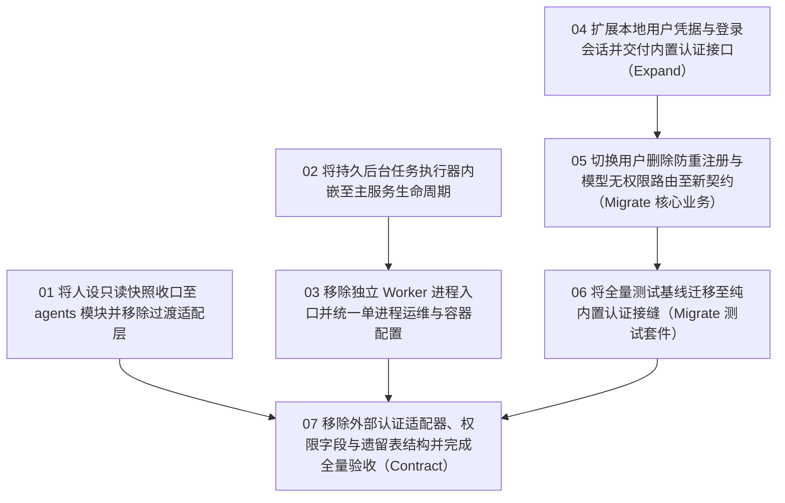

# 一体化单进程 Python 后端体系收敛

Status: ready-for-agent

## Problem Statement

Mem-AI 已完成 V1 的 18 个核心功能切片，覆盖带长期记忆的同步与流式对话、私有 Agent 与人设版本、PostgreSQL 持久任务、删除屏障、保留清理与生产观测。但现有实现仍沿用早期的“可拆分为独立记忆/人设服务、支持外部认证网关与权限点过滤、API 与独立 Worker 双进程分离”的过渡架构，带来了四类不必要的复杂度与断层：

1. **运行形态割裂**：在线 HTTP/SSE 服务与后台任务执行器被拆为两个独立进程入口、两套探针端口与两套连接池部署配置，增加了本地开发、容器编排、健康检查与运维心智，不符合“整体作为一个完整 Python 后端服务”的定位。
2. **内部拆分残留抽象**：人设管理与只读读取被人为拆成两个模块与一层独立的只读协议抽象，原本仅服务于“未来外置独立人设服务”的设想，如今反而增加了对话编排与测试的间接层。
3. **缺少自包含的内置用户认证闭环**：系统无法直接完成用户注册、登录、令牌刷新、主动注销与修改密码，反而维护了多套外部身份适配器、可信网关头校验与外部主体映射表。
4. **存在未启用却贯穿主链路的权限码负担**：身份上下文和模型配置中携带权限集合与模型权限过滤，但产品并不需要角色权限（RBAC）或管理后台，造成无谓的配置与校验复杂度。

## Solution

将 Mem-AI 收敛为**自包含、一体化的单进程 AI 对话应用 Python 后端服务**（依据已接受的 ADR-0007），在单一代码库、单一服务进程与 PostgreSQL 这一唯一必选有状态基础设施内，补齐并收口完整的后端体系：

1. **单进程内嵌持久后台任务执行器**：取消独立 Worker 进程与独立探针/指标端口，将基于 PostgreSQL 持久任务表（支持行锁跳过领取、租约续期、指数退避重试、外部核验与周期窗口去重）的后台任务执行器内嵌到应用生命周期中统一启动、监控与优雅排空；横向扩展采用同构单进程副本，并通过配置开关控制是否启用本副本的任务循环。
2. **人设边界彻底内聚**：移除独立人设适配模块与人设提供方协议，将人设草稿、版本发布、停用及对话时的只读人设版本快照解析全部归口到 `agents` 模块；仅保留面向外部第三方引擎的 `ModelProvider` 与 `MemoryProvider` 适配边界。
3. **纯内置认证闭环与无角色权限访问模型**：以本地 `email` + 强哈希密码、短期 Access Token（JWT）与落库可撤销 Refresh Token（`auth_sessions` 登录会话）构建完整的注册、登录、刷新、注销与改密接口，开放自助注册由服务端配置开关控制；移除外部 OAuth/SSO、可信网关头认证、外部身份映射、`permissions` 及模型 `required_permission` 过滤。所有活跃用户地位平等，仅通过“有效登录态 + 本人资源归属”两道防线保护私有数据并平等使用服务端已启用的全部模型。
4. **统一单进程运维与恢复基线**：将连接池预算、健康就绪、内嵌后台任务心跳与低基数指标收口到单一服务进程中，确保从 V1 数据库结构平滑迁移、删除防同邮箱重注册以及备份审计重放保持端到端一致。

## User Stories

### 单进程运行与内嵌后台任务执行器

1. As an operator, I want to start a single Python backend service process that handles both HTTP/SSE requests and durable background jobs, so that I do not need to deploy, monitor, or orchestrate a separate Worker process.
2. As a user, I want ordinary conversation memory writes, memory deletions, conversation cleanups, and user deletions to complete asynchronously inside the single backend process, so that chat latency stays low without requiring a separate worker deployment.
3. As an operator, I want durable background jobs to remain persisted in PostgreSQL across process restarts or crashes, so that in-flight memory writes, deletion barriers, and retention cleanups are never silently lost.
4. As an operator, I want to scale horizontally by running multiple identical single-process replicas against the same PostgreSQL database, so that both HTTP traffic and background jobs scale safely without duplicate execution.
5. As an operator, I want a configuration toggle to enable or disable the embedded background job loop on a given replica, so that I can pause background execution during maintenance or backup restoration without stopping the whole deployment mechanism.
6. As an operator, I want periodic generation lease recovery and retention cleanup jobs to be deduplicated across all running replicas via PostgreSQL window keys, so that running multiple single-process instances does not duplicate maintenance work.
7. As an operator, I want independent concurrency budgets for HTTP requests, active generations, and embedded background jobs within the same process, so that a surge in background cleanup jobs cannot starve live chat responses.
8. As an operator, I want graceful shutdown to mark the service unready, stop claiming new background jobs, drain in-flight synchronous generations and background jobs within bounded timeouts, and then close HTTP and database pools cleanly, so that deployments and restarts leave recoverable state.
9. As an operator, I want embedded background job heartbeat, active task count, job backlog, reconciling count, and execution metrics exposed through the main service's logs and controlled metrics endpoint, so that I do not need to scrape a separate worker probe port.
10. As an operator, I want the connection pool budget check tool to calculate total PostgreSQL connections based on homogeneous single-process replicas plus migration and operational headroom, so that database capacity planning matches the single-process architecture.
11. As an operator, I want the container image and local run commands to default to the unified single-process server, so that local development and production deployment share one consistent runtime model.

### 人设内聚与外部适配边界

12. As a persona owner, I want Agent creation, draft editing, immutable persona version publishing, retirement, and chat-time persona snapshot lookup to behave consistently from a single domain owner, so that persona semantics never diverge across layers.
13. As a user, I want starting a new conversation with my Agent to pin its latest published persona version directly from the `agents` module, so that subsequent draft edits, new version publications, or Agent retirement never alter existing conversations.
14. As a user, I want continuing an existing conversation to resolve its pinned persona version directly from the `agents` module, so that retired Agents can still serve historical conversations without error.
15. As a maintainer, I want the legacy read-only persona adapter module and persona provider contract removed, so that the codebase no longer carries dead seams built for an abandoned microservice split.
16. As a maintainer, I want `ModelProvider` and `MemoryProvider` retained strictly as adapters for external model and memory vendors, so that external HTTP protocols, retries, and test doubles remain cleanly isolated from Conversation Core.
17. As a maintainer, I want cross-module persistence boundaries preserved inside the monolith, so that retiring unnecessary provider seams does not allow modules to reach directly into each other's ORM models or repositories.

### 纯内置认证与登录会话生命周期

18. As a new user, I want to register an account with my email and password when self-registration is enabled, so that I can immediately start using the AI chat backend without an external identity provider.
19. As an operator, I want a server configuration flag to enable or disable self-registration, so that private or invite-only deployments can block unsolicited signups cleanly.
20. As a user, I want registering with an already taken email (normalized case-insensitively) to fail with a stable conflict error, so that duplicate accounts cannot be created for the same email.
21. As a user, I want registration and password updates to enforce password strength and length constraints, so that weak or malformed credentials are rejected before storage.
22. As a user, I want my password stored only as a salted strong password hash, so that raw passwords are never persisted or exposed in logs, responses, or database dumps.
23. As a user, I want to log in with my email and password to receive a short-lived Access Token and a Refresh Token, so that my client can authenticate API requests and maintain a persistent login session.
24. As a user, I want failed logins with an unknown email or wrong password to return the same stable unauthorized error without revealing whether the email exists, so that account enumeration is prevented.
25. As a user, I want to exchange a valid Refresh Token for a fresh Access Token and a rotated Refresh Token, so that long-lived client sessions remain secure and seamless.
26. As a user, I want reusing an already rotated or revoked Refresh Token to be rejected and invalidate the compromised login session chain, so that stolen refresh tokens cannot be silently abused.
27. As a user, I want the server to store only a cryptographic digest of each Refresh Token in persistent login sessions, so that a database leak cannot be used to forge session refreshes.
28. As a user, I want to log out of my current login session by revoking its Refresh Token, so that the client session can no longer mint new Access Tokens.
29. As a user, I want an option to log out from all of my active login sessions at once, so that I can revoke access across all devices if needed.
30. As a user, I want to change my password by providing my current password and a new password, so that I can rotate my credentials safely.
31. As a user, I want changing my password to revoke my other active login sessions immediately, so that previously issued sessions on untrusted devices cannot continue refreshing access.
32. As a user, I want expired or malformed Access Tokens to be rejected with a stable unauthorized error on all protected endpoints, so that unauthenticated callers cannot access private resources.
33. As a user, I want to fetch my own profile summary (including user ID, email, and status) from the current-user endpoint, so that my client can display my signed-in identity.
34. As a user, I want disabled accounts to be rejected immediately on login, token refresh, and every business request with a stable forbidden error, so that disabled users lose access without waiting for Access Token expiry.
35. As a user, I want expired login sessions to be purged automatically in bounded batches by the embedded retention cleanup job, so that the authentication session table does not grow without bound.

### 用户删除防重注册与删除一致性

36. As a user, I want initiating account deletion to immediately set my user status to `deleting` and revoke all of my active login sessions, so that no device can log in, refresh tokens, or invoke business APIs while deletion is underway.
37. As a user, I want my email address to remain reserved by my `deleting` user record until local data and external memory cleanup are fully confirmed, so that nobody (including myself) can re-register with the same email mid-deletion and collide with in-flight cleanup.
38. As a user, I want to continue querying my account deletion progress using only my one-time Deletion Receipt after my login sessions are revoked, so that deletion remains observable without keeping business access open.
39. As a user, I want my user record, password hash, and revoked login sessions to be physically removed once local and external memory cleanup are confirmed complete, so that the same email can only be registered again as a fresh user after full deletion finishes.
40. As an operator, I want the backup-restore audit replay workflow to remain compatible with built-in users and sessions, so that restoring a database snapshot still revokes deleted users and prevents resurrecting deleted memories.

### 移除外部认证与角色权限后的简化边界

41. As a user, I want to view and select any server-registered enabled model without needing extra role or permission claims, so that all active users have consistent access to available models.
42. As a user, I want requests referencing an unregistered or disabled model ID to continue failing with stable configuration errors before calling any external model provider, so that model routing remains strictly server-controlled.
43. As a user, I want strict ownership isolation across all of my Agents, conversations, messages, generations, memories, and operations, so that other authenticated users always receive a `404` when probing my resource IDs.
44. As an operator, I want legacy external authentication adapters (development fixed identity, static test tokens, external issuer JWT verification, and trusted gateway header verification) removed from runtime configuration and middleware, so that authentication has one auditable code path and cannot be misconfigured with forged identity headers.
45. As an operator, I want legacy permission sets and model `required_permission` fields removed from authentication context, model configuration, and routing, so that there is no dead authorization code or confusing unused configuration.
46. As an operator, I want model configuration synchronization and operational recovery to remain controlled through server configuration, startup/CLI model sync, controlled `/metrics`, and the ops CLI rather than unrequested HTTP admin endpoints, so that the public HTTP surface stays minimal and secure.
47. As an operator, I want existing V1 PostgreSQL databases to migrate cleanly via Alembic to the new user credential and login session schema without breaking existing Agents, conversations, memories, jobs, or operations, so that upgrades are safe and verifiable.
48. As a maintainer, I want architecture and documentation checks updated to enforce the converged module layout and fail if retired modules or forbidden cross-module imports reappear, so that the codebase stays aligned with the unified single-process design.

## Implementation Decisions

### 1. 收敛策略与模块归属调整

整个收敛保持 PostgreSQL 为唯一必选有状态基础设施，不引入 Redis、Celery 或独立消息队列，也不拆分内部服务或引入 Cordis。变更围绕三个清晰且可独立验证的领域边界展开：

- **单进程后台任务内嵌（`application` + `workers` + `health` + `core` + `ops`）**：
  - 将后台任务处理器装配与 `WorkerRunner` 的启动、周期任务调度、心跳上报和优雅停机排空统一迁入 FastAPI 应用工厂的 `lifespan`。
  - 通过显式配置项（如启用开关、后台任务并发上限、轮询间隔、租约与退避参数、排空宽限时长）控制进程内后台任务执行器；在应用实例上保留对执行器实例的引用以支持观测与测试确定性步进。
  - 移除独立的 Worker 进程启动入口、独立 Worker 探针 ASGI 应用以及独立 Worker 指标监听端口配置；将后台任务心跳与执行指标直接合入主应用共享的 `TelemetryRegistry`、主日志流与受控 `/metrics` 端点。
  - 优雅停机按顺序执行：置就绪状态为未就绪 → 停止后台任务执行器领取新任务 → 在有界宽限内并行排空在途同步生成任务与在途后台任务 → 关闭共享 HTTP 客户端与数据库连接池。
  - 更新连接预算计算与健康诊断 CLI（`ops`），按同构单进程副本总数（而非拆分的 API 副本数 + Worker 副本数）核对 PostgreSQL 总连接预算，并在配置校验中确保单进程连接池足以覆盖在线请求与内嵌后台任务并发。
  - 保留统一 `jobs`、`job_attempts` 表、`memory_jobs` 只读视图以及 `FOR UPDATE SKIP LOCKED`、租约续期、退避抖动、`reconciling` 核验与周期窗口去重契约不变。

- **人设边界内聚回 `agents`（`agents` + `conversations` + `contracts`）**：
  - 将人设不可变快照数据类型（`PersonaSnapshot`、`MemoryPolicy`、`MemoryWriteScope`）以及按拥有者查询最新已发布版本、按版本 ID 查询固定版本的公开只读服务入口迁入 `agents` 模块。
  - 迁移 `conversations` 模块及其相关调用方，直接调用 `agents` 公开只读服务获取人设快照，继续保持在写事务外读取快照以缩短数据库持锁时间。
  - 删除过渡的 `personas` 模块与 `PersonaProvider` 协议定义，从应用装配 `ProviderRegistry` 中移除人设提供方槽位；`ProviderRegistry` 仅保留外部依赖协议 `ModelProvider` 与 `MemoryProvider`。
  - 同步更新跨模块分层架构约束：`conversations` 允许调用 `agents` 的公开服务与数据模型，仍禁止访问 `agents` 的 Repository 与 ORM 模型。

- **纯内置认证闭环与权限裁剪（`auth` + `users` + `models` + `conversations` + `retention` + `api`）**：
  - 在 `users` 模块为 `users` 表补充本地登录凭据字段：规范化后的唯一 `email`（大小写不敏感唯一约束，保存规范化小写值）与 `password_hash`（使用强口令派生哈希算法，例如 Argon2id 或 scrypt/PBKDF2-HMAC-SHA256，带随机盐与固定时间比较）。
  - 在 `auth` 模块引入 `auth_sessions` 持久化表，记录 `id`、`user_id`、`token_hash`（仅存 Refresh Token 的 HMAC/SHA-256 摘要，不存明文）、`expires_at`、`revoked_at`、`replaced_by_session_id`、`created_at` 与 `last_used_at`，并建立按 `token_hash` 唯一索引及按 `(user_id, revoked_at)`、`(expires_at, id)` 的查询与保留清理索引。
  - 新增并收口 `auth` 路由与服务契约，统一沿用 `{success, code, message, data, request_id}` 响应外壳与 `camelCase` 业务载荷字段：
    - `POST /v1/auth/register`：校验自助注册开关、邮箱格式与唯一性、密码策略，原子创建 `active` 本地用户并签发首个登录会话（Access Token + Refresh Token），返回 `201`。关闭注册时返回稳定的 `403 registration_disabled`；邮箱已存在（含 `deleting` 占位）返回 `409 email_already_registered`。
    - `POST /v1/auth/login`：校验邮箱密码与用户状态（`active`）；未知邮箱或密码错误统一返回 `401 invalid_credentials`（防止用户枚举）；用户为 `disabled` 或 `deleting` 返回 `403`；成功创建 `auth_sessions` 记录并返回 `200` 与 Access Token、Refresh Token 及过期秒数。
    - `POST /v1/auth/refresh`：校验 Refresh Token 摘要与登录会话有效性、用户 `active` 状态；在单事务中原子轮换为新 `auth_sessions` 记录并标记旧会话为已轮换；若检测到已被轮换或已吊销的旧 Refresh Token 重放，立即吊销该会话家族并返回 `401 invalid_credentials`。
    - `POST /v1/auth/logout`：支持按传入 Refresh Token 吊销当前登录会话，或携带 `allSessions: true` 配合有效 Access Token 吊销该用户全部活跃登录会话，返回 `204`（或统一成功响应，保持幂等）。
    - `POST /v1/auth/password`：需有效登录态，校验当前密码与新密码策略，更新 `password_hash` 并在同一事务中吊销该用户其余（或全部）活跃登录会话，返回 `200`。
  - 精简 `AuthenticationContext`：仅保留 `user_id`、`email`、`session_id`（如适用）与 `auth_method`，移除 `VerifiedPrincipal`、`actor_id` 与 `permissions` 字段。
  - 移除 `DevelopmentAuthAdapter`、`StaticTokenAuthAdapter`、`TrustedGatewayAuthAdapter`、外部 `issuer`/`audience` 校验及 `user_identities` 外部身份映射表；清理配置与中间件中仅用于可信网关头的校验分支（继续保留伪造代理头保护、可信代理 IP 解析、`X-Request-Id` 白名单、Host/CORS 白名单及删除回执 `DeletionReceipt` 与普通业务路由隔离）。
  - 裁剪模型权限过滤：从 `model_configs` 表、模型同步种子结构与模型路由策略中移除 `required_permission`，保留服务端强制模型策略、是否允许请求指定 `modelId` 开关、模型启用状态与流式能力校验。
  - 更新用户删除协调逻辑：发起 `DELETE /v1/users/me` 时在同一事务中将 `users.status` 置为 `deleting`、立即批量吊销该用户全部 `auth_sessions`、创建删除操作与删除回执并入队 `user_delete` 任务；删除期间保留 `users` 行占位以阻止同邮箱重复注册，待本地资源与外部记忆清理全部确认后在最终事务中物理删除 `auth_sessions` 与 `users`。
  - 扩展 `retention` 周期清理：增加对已过期或长期已吊销 `auth_sessions` 记录的有限批次游标清理，防止表膨胀，同时保护仍活跃的登录会话。
  - 保持所有既有核心契约不变：`POST /v1/chat` 必填 `Idempotency-Key`、同会话生成租约与过期内联接管、SSE 事件契约、记忆范围与删除屏障、单条/清空/会话/用户删除回执、低基数 Prometheus 指标与脱敏 JSON 日志。

### 2. 数据库迁移与兼容性

- 提供清晰的 Alembic 迁移脚本：
  - 为 `users` 新增规范化 `email`（唯一约束）与 `password_hash` 列；为兼容历史升级路径测试，对迁移前已存在的旧测试/历史行给出确定性的占位回填或约束升级策略。
  - 新建 `auth_sessions` 表及配套索引。
  - 移除不再使用的 `user_identities` 表与 `model_configs.required_permission` 列。
- 所有迁移须通过空库升级、历史 V1 版本库升级及 `alembic check` 漂移检测。

### 3. 工程目录与架构检查同步

- 同步更新工程设计文档的目录树、当前目录状态表、功能定位索引与职责表，移除 `personas` 过渡项、`workers` 独立进程入口描述及外部认证/权限残留说明。
- 同步更新架构检查工具的装配例外列表（移除独立 Worker 入口例外），确保新增或调整的模块依赖关系受到静态导入检查与重复路由检查保护。

## Testing Decisions

### 测试原则

- 只验证**用户和运维可见的外部行为**（HTTP 状态码、统一响应信封与错误码、SSE 事件流、持久化结果、任务最终状态、指标与健康输出、CLI 退出码与诊断报告），不耦合内部私有函数或实现细节。
- 最小化测试替身数量，尽量通过最高层公开接缝直接驱动真实应用装配、真实认证与真实 PostgreSQL。

### 已确认的测试接缝

1. **单一最高层应用接缝（主接缝）**：复用现有基于 `create_app` + FastAPI `lifespan` + HTTPX ASGI 客户端 + 隔离迁移 PostgreSQL 数据库的测试夹具。
   - **移除冗余替身**：不再使用 `FakePersonaProvider`（直接通过 `/v1/agents` 创建与发布真实人设）与 `StaticTokenAuthAdapter` / 外部主体构造器（直接通过 `/v1/auth/register` 与 `/v1/auth/login` 建立真实登录态与多用户隔离测试）。
   - **保留外部第三方边界替身**：仅在 `ProviderRegistry` 注入可控的 `FakeModelProvider` 与 `FakeMemoryProvider`，模拟上游模型延迟、失败、流中断与外部记忆召回降级、超时未知、核验与部分失败。
2. **内嵌后台任务执行器控制点（挂在主应用接缝上）**：
   - **完整异步运行模式**：测试内嵌执行器随 `lifespan` 自动启动、在线请求与后台任务共享进程并发限制、优雅停机排空，以及同时启动两个同构 `create_app` 实例验证多副本 `SKIP LOCKED` 领取与周期窗口去重。
   - **确定性步进模式**：通过测试配置关闭自动轮询循环，按需触发应用实例上的内嵌执行器单步 `run_once`，无时间抖动地验证退避重试、记忆删除屏障、用户删除防同邮箱重注册及过期登录会话/保留期分批清理。
3. **迁移、运维 CLI 与架构检查接缝**：
   - 复用现有 Alembic 空库与历史 V1 库升级集成测试。
   - 复用 `ops` 与模型同步公开 CLI 测试，验证单进程连接预算校验、健康诊断、审计归档重放与任务重入队。
   - 复用架构检查脚本与架构测试集，验证收敛后的目录索引、模块所有权、文档链接与分层导入规则。

### 覆盖重点与既有参考

沿用现有单元、API、集成与架构四类测试分层作为先例，重点覆盖：

- **内置认证与登录会话**：注册开关、邮箱大小写去重、密码策略、登录防枚举、Access Token 验签与过期、Refresh Token 轮换与重放吊销家族、单会话注销与全会话注销、改密吊销其余会话、停用/删除用户即时 `403`、过期会话保留清理。
- **用户删除与防重注册**：删除受理立即吊销全部登录会话、删除期间同邮箱重新注册返回 `409`、Deletion Receipt 持续可查但业务接口全部拒绝、本地与远程清理确认后物理删除用户并允许作为全新用户重新注册。
- **人设内聚与模型无权限过滤**：`conversations` 直接读取 `agents` 快照的草稿隔离/固定版本/停用续聊行为；任意活跃用户均可发现并选用全部已启用注册模型，未注册/停用模型仍在调用上游前拒绝。
- **单进程内嵌任务与多副本**：单进程完整闭环（聊天 → 异步记忆写入 → 召回 → 删除屏障）、多同构副本并发不重不漏、进程并发隔离与优雅停机排空、历史 V1 库升级兼容与备份审计重放。

## Out of Scope

- 外部 OAuth2 / OIDC / SSO、第三方身份提供商绑定与可信网关身份头认证。
- 角色权限（RBAC）、管理员角色、自定义权限点与 HTTP 管理后台（`/v1/admin/*`）。
- 将记忆、人设或模型模块拆分为独立微服务，或实现远程内部适配器。
- Cordis 或任何运行时插件系统与插件市场。
- 引入 Redis、Celery、RabbitMQ 或 Kafka 作为必选基础设施依赖。
- 用户自定义模型 API Key、自定义 Base URL 或自动模型故障转移。
- 多租户工作区、团队共享 Agent / 人设或团队共享记忆。
- 邮箱验证发信通道（SMTP）、短信登录、找回密码邮件流、双因素认证（2FA）等外围运营认证扩展（可作为后续增强能力）。
- 前端界面、知识库/RAG、通用工具调用（MCP）及多模态输入输出。

## Further Notes

- 本规格与已更新的 [总体设计](../../DESIGN.md)、[后端脚手架工程设计](../../docs/backend-scaffold-design.md)、[领域术语](../../GLOSSARY.md) 及 [ADR-0007](../../docs/adr/0007-unified-single-process-backend.md) 保持完全一致。
- 原 V1 规格（[ai-chat-memory spec](../ai-chat-memory/spec.md)）记录了 01–18 初始切片的历史验收基线；本规格定义在此基线之上向一体化单进程后端体系收敛的目标契约。
- 具体拆解切片与阻塞关系见下方 `## Implementation Plan`。

## Implementation Plan

7 个收敛切片按直接阻塞关系推进，每张 ticket 为对应切片的交付与验收入口。`ready-for-agent` 表示可承接，执行前需确认全部直接阻塞项已完成。

| ticket | 交付 | 直接阻塞 |
| --- | --- | --- |
| [01 将人设只读快照收口至 agents 模块并移除过渡适配层](issues/01-consolidate-persona-snapshots-into-agents.md) | 将不可变人设版本快照类型与只读快照查询归口 `agents`，对话核心直接调用并移除过渡 `personas` 模块与 `PersonaProvider` 协议。 | 无 |
| [02 将持久后台任务执行器内嵌至主服务生命周期](issues/02-embed-durable-job-runner-in-app-lifespan.md) | 在主 FastAPI 应用 `lifespan` 中装配、启停并优雅排空持久后台任务执行器，心跳与指标并入主服务观测体系。 | 无 |
| [03 移除独立 Worker 进程入口并统一单进程运维与容器配置](issues/03-retire-standalone-worker-and-unify-ops.md) | 移除独立 Worker 进程入口与独立探针/指标端口，统一连接池预算、容器镜像、运行手册与架构检查装配例外。 | 02 |
| [04 扩展本地用户凭据与登录会话并交付内置认证接口（Expand）](issues/04-add-builtin-auth-and-login-sessions.md) | 为 `users` 扩展唯一邮箱与密码哈希，新增 `auth_sessions` 并交付 `/v1/auth/*` 内置认证接口与过期会话保留清理。 | 无 |
| [05 切换用户删除防重注册与模型无权限路由至新契约（Migrate 核心业务）](issues/05-migrate-user-deletion-and-permissionless-models.md) | 切换用户删除为立即吊销全部登录会话并保留 `deleting` 占位防同邮箱重注册，扩展 `GET /v1/users/me` 并移除模型权限过滤。 | 04 |
| [06 将全量测试基线迁移至纯内置认证接缝（Migrate 测试套件）](issues/06-migrate-test-suite-to-builtin-auth-seam.md) | 将共享测试夹具与全量 API/集成/单元测试从静态令牌与外部主体替身迁移至内置注册登录会话接缝。 | 05 |
| [07 移除外部认证适配器、权限字段与遗留表结构并完成全量验收（Contract）](issues/07-contract-external-auth-permissions-and-verify-v2.md) | 移除外部认证适配器、`permissions`、`user_identities` 表与 `model_configs.required_permission` 列，完成迁移升级与单进程端到端验收。 | 01、03、06 |

