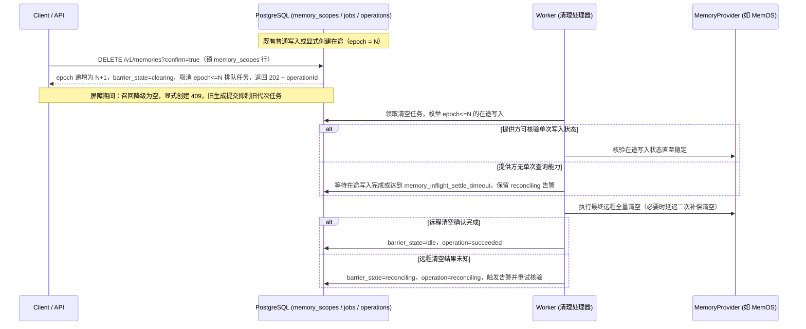

# 后端脚手架工程设计

设计日期为 2026 年 11 月 20 日。本文规定 Mem-AI 的后端工程结构、技术选型、数据库访问、接口规范、测试与部署方案，作为后续实现的依据。

业务范围和提供方职责见 [总体设计](../DESIGN.md)，领域术语见 [GLOSSARY.md](../GLOSSARY.md)。本文遵循已有的模块化单体、提供方接口和应用主数据决策。

## 1. 技术选型

采用 FastAPI、PostgreSQL 17、SQLAlchemy 2.x 异步 ORM、psycopg 3 和 Alembic。

| 领域 | 选择 | 用途 |
| --- | --- | --- |
| Python | 3.13 | 固定项目运行时 |
| Web 框架 | FastAPI | 路由、依赖注入、参数校验、OpenAPI |
| ASGI 服务 | Uvicorn | 开发和生产服务进程 |
| 数据库 | PostgreSQL 17 | 持久化应用主数据和后台任务 |
| ORM | SQLAlchemy 2.x | 类型化模型、查询、事务、连接池 |
| PostgreSQL 驱动 | psycopg 3 | 运行时异步访问及迁移同步访问 |
| 数据库迁移 | Alembic | 数据库结构版本管理 |
| 数据校验 | Pydantic 2 | 请求、响应及内部数据模型 |
| 配置管理 | pydantic-settings | 环境变量读取与配置校验 |
| 包管理 | uv | 依赖管理和锁文件 |
| 外部 HTTP 调用 | HTTPX | 连接复用、异步请求、超时控制 |
| 测试 | pytest、AnyIO、HTTPX | 单元测试、数据库集成测试、接口测试 |
| 静态检查 | Ruff、mypy | 格式、lint、类型检查 |
| 日志 | 标准 logging 与 JSON formatter | 结构化日志 |

Python 版本和连接池等参数属于初始工程选择。依赖兼容范围在 `pyproject.toml` 中声明，实际安装版本通过 `uv.lock` 固定，CI 和部署使用锁文件同步依赖。

### 1.1 ORM 选择

SQLAlchemy 2.x 适合本项目对 PostgreSQL 数据类型、关联查询、显式事务以及后台任务并发控制的需求。

- ORM 模型使用 `DeclarativeBase`、`Mapped` 和 `mapped_column`。
- 查询使用 `select()`、`insert()` 和 `update()`。
- 运行时使用 `AsyncEngine`、`async_sessionmaker` 和 `AsyncSession`。
- 请求和响应分别定义 Pydantic Schema。
- 业务运行时和迁移均使用 psycopg 3，通过引擎类型选择异步或同步访问。
- Alembic 统一管理业务表结构。

数据库连接地址通过 SQLAlchemy `URL.create()` 组装，驱动名使用 `postgresql+psycopg`。

## 2. 架构和职责

采用按业务模块组织的模块化单体。

```text
HTTP 请求
    ↓
Middleware
    ↓
Router + Dependencies
    ↓
Service
    ├── Repository → SQLAlchemy → PostgreSQL
    └── 项目提供方接口 → 具体适配器
```

| 层级 | 职责 |
| --- | --- |
| Middleware | 请求标识、访问日志和跨域等通用 HTTP 处理 |
| Router | 请求参数、HTTP 状态码、响应 Schema、调用业务服务 |
| Dependencies | 当前身份、服务实例和应用资源注入 |
| Service | 本模块公开用例和权限策略，事务由明确的阶段入口控制 |
| Repository | 查询、持久化、批量操作和数据库锁 |
| Model | 表结构、关联、索引和数据库约束 |
| Schema | 请求输入和对外输出的数据契约 |
| Provider | 对话内核使用的模型、记忆和人设能力接口 |

工程约定如下。

- Router 保持简短，业务流程集中在 Service。
- Repository 接受显式传入的 `AsyncSession`。
- 每个事务阶段指定一个负责入口，一个原子操作涉及的模块通过公开的事务参与方法共享 Session。
- 模块之间通过服务或已有提供方接口协作。
- 数据库仓储使用具体实现，出现实际替换需求时再增加接口。
- 对话内核依赖项目定义的 `ModelProvider`、`MemoryProvider` 和 `PersonaProvider`。
- 具体提供方客户端、SQLAlchemy 模型和 HTTP 细节封装在各自实现中。

### 2.1 事实维护位置

| 内容 | 主要维护位置 |
| --- | --- |
| 产品行为和验收范围 | spec，ticket 引用并细化对应切片 |
| 业务流程和一致性原则 | `DESIGN.md` |
| 模块所有权、依赖、接口、表和事务契约 | 本文 |
| 架构选择的理由与取舍 | 已接受 ADR |
| 领域词义 | `GLOSSARY.md` |
| 实际符号、调用方与验证记录 | 代码、测试及 ticket 完成记录 |

调整约定时修改对应维护位置，并更新引用。遇到验收、ADR 和实现之间的矛盾时定位具体差异，按已授权范围修正并记录依据。需要改变产品范围或已接受架构选择时先明确该决策。

### 2.2 模块所有权

下表指定逻辑写入入口。受控迁移负责结构与历史数据升级，批量清理由资源模块提供可恢复入口。应用公共接口返回项目数据类型，ORM 对象保留在持久化实现内部。

| 模块或入口 | 拥有的资源与规则 | 协作方式 |
| --- | --- | --- |
| `auth` | 凭证验证和可信身份上下文 | 通过 `users` 解析本地用户 |
| `users` | `users`、`user_identities`、用户状态和用户删除协调 | 清理处理器调用资源模块批量清理入口 |
| `agents` | `agents`、`persona_versions`、草稿（存 `agents` 行）、不可变版本快照分配、发布与停用 | 管理 API 唯一写入入口，发布快照和当前版本引用同事务更新 |
| `personas` | `PersonaProvider` 的本地只读适配 | 委托 `agents` 只读解析最新或固定版本快照，不承担管理写操作 |
| `conversations/service.py` | Conversation Core 的准备、执行和收敛编排 | 事务外读取人设与召回，调用生成阶段入口、模型路由、提供方和纯 Prompt 编译 |
| `conversations/generation.py` | `conversations`、`messages`、`generations`、召回引用的持久化阶段及生成终态 | 统一创建、租约（含过期接管）、成功、失败、取消和过期恢复，协作方法参与同一 Session |
| `conversations/idempotency.py` | `idempotency_records`、业务摘要与原结果解析 | 由生成阶段在所属事务中占位和更新结果 |
| `models` | `model_configs`、受控配置同步、模型选择与 `ModelProvider` 适配 | 对话编排使用模型选择结果和项目协议 |
| `memories` | `memory_scopes`、`memory_tombstones`、`memory_list_snapshots`、范围归属、代次、屏障与访问策略 | 对话与清理流程调用同一策略，任务处理器调用 `MemoryProvider` |
| `jobs` | `jobs`、`job_attempts`、领取、续租、去重、重试和任务状态 | 业务处理器返回执行结果，由执行框架记录状态 |
| `operations` | `operations`、删除状态转换、阶段进度、回执权限与独立删除审计归档接缝 | 资源清理处理器报告结果，通过统一入口推进操作并导出审计记录 |
| `retention` | 保留期限、扫描批次与清理选择（含幂等、日志及分页快照） | 调用资源模块的批量清理入口并复用 `jobs` |
| `workers` | 进程生命周期、处理器注册与并发调度 | 装配业务处理器，调用 `jobs` 执行框架 |

`agents` 向 `personas` 提供本地只读查询入口，依赖方向为 `personas` → `agents`。`personas` 按只读适配职责组织，表定义与全部写操作集中在 `agents`。具体适配器仅在装配处绑定到项目协议。

记忆检索与写入范围包含用户级（`user`）和会话级（`conversation`）。普通对话回合写入范围由固定人设快照中的 `memoryPolicy.writeScope` 控制（默认 `user`，可配置为 `conversation`）；显式创建默认 `user`，支持显式指定 `scope="conversation"` 并校验 `conversationId` 归属。代次与全量清空屏障按 `(user_id, provider_id)` 管理。会话删除通过会话的 `deleting` 状态和会话范围删除标记隔离写入，记忆策略同时检查用户代次与会话有效性。会话级清理保留用户级记忆。

召回、显式创建、后台写入和删除均经过 `memories` 的公共策略入口，具体 `MemoryProvider` 适配器由这些入口在校验后调用。Conversation Core 使用项目协议接入受策略保护的记忆能力。

### 2.3 依赖方向和公开入口

- Router 调用本模块公开用例，HTTP 编码集中在 Router 和传输适配层。
- 跨模块调用以公开服务、项目协议和项目数据类型为入口，各模块 Repository 与 ORM 模型由所属模块内部使用。
- 事务协作方法显式接收调用方 Session，完成查询、锁和写入后将提交权交回阶段入口。资源权限规则由资源模块统一定义，入口校验和提交前重新校验共同调用该规则。
- Conversation Core 通过生成阶段入口访问应用持久化，通过项目协议访问模型、记忆和人设。SQLAlchemy 和供应商 HTTP 封装在对应实现中。
- Prompt 编译是纯数据转换，SSE 编码负责传输表达，生成状态转换通过共享生成入口执行。
- `jobs` 依赖通用任务数据和处理器协议，业务处理器依赖资源服务。处理器注册集中在 Worker 装配处，通用任务模块保持单向依赖。
- 数据库模型注册、迁移元数据导入、API 装配（`application.py`/`main.py`/`api/router.py`）和 Worker 装配（`workers/main.py`）属于显式基础设施入口，架构检查按具体文件列出例外。为新增依赖补充这里的用途与方向。

实现时在模块首次提供公共行为时确定公开符号，并在对应 ticket 记录路径和调用方式。公共接口和允许依赖随实际实现更新，现有调用方一并迁移。

### 2.4 文件职责与演进

`service.py` 按模块公开用例组织。独立的状态转换、传输编码、外部适配和纯编译逻辑按上表分工。出现多组独立修改原因、双向导入或多处相同状态判断时，检查职责和调用方，收敛到负责该规则的入口。

按需创建文件，拆分后的每个文件说明自身职责及调用关系。提取公共实现时迁移已有调用方并清理替代路径，以公开行为测试验证兼容性。文件行数用于辅助定位，职责和调用关系决定拆分。

## 3. 工程目录

本节是项目的唯一工程导航入口。AI 开始实现前先读取本节的功能定位索引，再沿索引进入模块所有权、计划入口、测试位置和对应 ticket。目录树描述目标结构，索引和实际文件共同决定当前状态，文档中标记为计划的路径必须先通过文件系统确认是否已经落地。

### 3.0 AI 导航入口

按以下顺序查找已有能力。

1. 在功能定位索引中找到业务能力，读取对应负责模块和相关 ticket。
2. 检查目录树和实际文件，区分已落地文件与计划文件，不根据计划路径假定实现已经存在。
3. 读取模块所有权和公开入口约定，确认资源、状态转换和事务阶段的唯一负责人。
4. 在负责模块内搜索已有符号及其调用方，再决定扩展、迁移或新增入口。
5. 完成后更新本节的路径、职责、状态和功能索引，并在 ticket 的 `## Answer` 中记录实际符号与验证证据。

功能定位索引按业务能力维护唯一负责人。一个能力需要多个文件协作时，只登记一个编排或资源所有者，其余文件登记为协作入口。新增实现前必须先判断它属于已有能力，避免通过新文件绕过已有所有者。

### 3.0.1 当前目录状态

状态用于帮助 AI 判断查找范围。具体文件是否存在以工作树为准，文件落地后需要在对应 ticket 的 `## Answer` 中记录并同步本节。

| 路径 | 当前状态 | 查找规则 |
| --- | --- | --- |
| `AGENTS.md`、`DESIGN.md`、`GLOSSARY.md` | 已落地 | 读取规则、业务流程和领域词义 |
| `DESIGN-REVIEW.md` | 已落地 | 读取设计评审发现的待决问题及建议处理切片 |
| `docs/`、`docs/adr/`、`docs/agents/` | 已落地 | 读取工程契约、决策和任务维护规则 |
| `.scratch/ai-chat-memory/` | 已落地 | 读取当前规格、依赖和实现边界 |
| `.agents/skills/` | 已落地 | 按任务读取适用技能，技能文件不作为业务实现入口 |
| `tools/check_architecture.py` | 已落地 | 校验工程目录、功能索引、文档链接、分层导入、装配例外、重复字面量路由、ticket 依赖图和源码文件规模 |
| `compose.yaml`、`.env.example`、`Makefile`、`pyproject.toml`、`uv.lock`、`.python-version`、`alembic.ini` | 已落地 | 本地依赖（支持 `POSTGRES_DATA_DIR` 自定义数据卷路径）、配置模板、快捷命令、锁定依赖与迁移配置 |
| `migrations/`、`.github/workflows/checks.yml` | 已落地 | Alembic 同步迁移基线与最小 CI 检查流水线 |
| `src/mem_ai/main.py`、`src/mem_ai/application.py`、`src/mem_ai/core/config.py`、`src/mem_ai/core/logging.py`、`src/mem_ai/core/exceptions.py`、`src/mem_ai/core/exception_handlers.py`、`src/mem_ai/api/`、`src/mem_ai/db/`、`src/mem_ai/contracts/`、`src/mem_ai/integrations/`、`src/mem_ai/modules/health/` | 已落地 | 01 基础脚手架、应用装配、提供方协议、公共分页、错误处理与健康检查 |
| `src/mem_ai/modules/auth/`、`src/mem_ai/modules/users/models.py`、`src/mem_ai/modules/users/schemas.py`、`src/mem_ai/modules/users/repository.py`、`src/mem_ai/modules/users/service.py`、`src/mem_ai/modules/users/router.py` | 已落地 | 02 认证上下文、可替换凭证验证适配器、伪造身份头清理、`users`/`user_identities` 主体映射与 `GET /v1/users/me` |
| `src/mem_ai/modules/agents/`、`src/mem_ai/modules/personas/provider.py` | 已落地 | 03/11 私有 Agent 与不可变人设版本快照（`agents`/`persona_versions`）、草稿编辑、原子发布、幂等停用（`DELETE /v1/agents/{agentId}`）、并发条件更新冲突保护与本地只读 `PersonaProvider` 适配 |
| `src/mem_ai/modules/jobs/`、`src/mem_ai/modules/operations/`、`src/mem_ai/modules/memories/models.py`、`src/mem_ai/modules/memories/schemas.py`、`src/mem_ai/modules/memories/repository.py`、`src/mem_ai/modules/memories/snapshots.py`、`src/mem_ai/modules/memories/recall.py`、`src/mem_ai/modules/memories/jobs.py`、`src/mem_ai/modules/memories/service.py`、`src/mem_ai/modules/memories/router.py`、`src/mem_ai/modules/memories/adapters/memos.py`、`src/mem_ai/workers/` | 已落地 | 04/08/09 统一任务表（`jobs`）、执行摘要表（`job_attempts` 独立保留期）、只读视图（`memory_jobs`）、SKIP LOCKED 领取/租约/退避抖动/令牌条件提交与独立 Worker 框架（`workers/runner.py`、`workers/main.py`）、异步操作追踪（`operations` 与 `GET /v1/operations/{operationId}`）、记忆范围与分页快照（`memory_scopes`/`memory_list_snapshots`）、`GET/POST /v1/memories`、统一范围召回筛选/去重/冲突与预算策略、普通回合异步写入与核验处理器（`memories/jobs.py`）及可替换 MemOS 适配器 |
| `src/mem_ai/modules/models/models.py`、`src/mem_ai/modules/models/schemas.py`、`src/mem_ai/modules/models/repository.py`、`src/mem_ai/modules/models/service.py`、`src/mem_ai/modules/models/router.py`、`src/mem_ai/modules/models/sync.py`、`src/mem_ai/modules/models/adapters/openai_compatible.py`、`src/mem_ai/modules/conversations/models.py`、`src/mem_ai/modules/conversations/schemas.py`、`src/mem_ai/modules/conversations/repository.py`、`src/mem_ai/modules/conversations/prompt.py`、`src/mem_ai/modules/conversations/idempotency.py`、`src/mem_ai/modules/conversations/queries.py`、`src/mem_ai/modules/conversations/generation.py`、`src/mem_ai/modules/conversations/service.py`、`src/mem_ai/modules/conversations/router.py` | 已落地 | 05–10 模型注册启动与显式 CLI 幂等同步（`model_configs`）、`GET /v1/models` 发现、服务端强制/覆盖/权限/能力路由策略、OpenAI 兼容 `ModelProvider` 适配器、共享生成生命周期与持久化阶段（`conversations`/`generations`/`messages`/`message_recalled_memories`/`idempotency_records`）、同会话单活跃生成租约与续期心跳、令牌/有效期/状态条件校验、过期租约内联接管与 Worker 兜底恢复、纯 Prompt 编译与上下文预算、范围记忆召回/降级与元数据引用落库、Tx 2 原子普通记忆任务入队、必填 `Idempotency-Key` 业务摘要与 24 小时终态保留/原结果回放（`idempotency.py`）、共享会话归属策略与只读生成/消息查询（`queries.py`，含 `DatabaseConversationAccessChecker`/`DatabaseTurnContentLoader`）、客户端断连隔离同步对话、`POST /v1/chat` 与 `GET /v1/conversations/{conversationId}/generations/{generationId}` |
| `tests/conftest.py`、`tests/unit/`、`tests/api/`、`tests/integration/`、`tests/architecture/` | 已落地（持续扩展） | 01–11 测试 fixture、单元、API、PostgreSQL/迁移、Worker 恢复、提供方契约与架构测试 |
| `src/mem_ai/core/limits.py`、`src/mem_ai/core/telemetry.py`、`src/mem_ai/modules/users/cleanup.py`、`src/mem_ai/modules/conversations/stream.py`、`src/mem_ai/modules/conversations/cleanup.py`、其余业务模块 | 按切片落地 | 先检查实际文件，再沿功能定位索引进入 |

### 3.0.2 功能定位索引

下表中的路径是当前设计约定。路径只有在实际文件存在并记录完成证据后才可视为可调用入口。

| 业务能力 | 主负责人 | 协作路径 | 首要查找路径 | 相关验证位置 | 相关 ticket |
| --- | --- | --- | --- | --- | --- |
| 应用装配、配置、错误和健康检查 | `application` | `core/`、`modules/health/` | `src/mem_ai/application.py`、`src/mem_ai/core/`、`src/mem_ai/modules/health/service.py`、`src/mem_ai/modules/health/router.py` | `tests/architecture/`、`tests/api/` | 01、17、18 |
| 认证上下文和用户状态 | `auth` | `users/` | `src/mem_ai/modules/auth/`、`src/mem_ai/modules/users/` | `tests/unit/`、`tests/api/`、`tests/integration/` | 02、15 |
| Agent 与人设版本生命周期 | `agents` | `src/mem_ai/modules/personas/provider.py` | `src/mem_ai/modules/agents/` | `tests/api/`、`tests/integration/` | 03、11 |
| 同步与流式生成编排 | `conversations` | `models/`、`memories/`、`jobs/` | `src/mem_ai/modules/conversations/service.py`、`generation.py`、`idempotency.py`、`queries.py`、`stream.py` | `tests/api/`、`tests/integration/` | 05、07、08、10、12 |
| 模型注册、选择和提供方调用 | `models` | `contracts/model_provider.py`、`models/adapters/` | `src/mem_ai/modules/models/`、`src/mem_ai/contracts/model_provider.py` | `tests/unit/`、`tests/api/`、`tests/integration/` | 05、06、12 |
| 记忆范围、召回、写入和删除策略 | `memories` | `contracts/memory_provider.py`、`memories/adapters/`、`memories/snapshots.py`、`memories/recall.py`、`memories/jobs.py` | `src/mem_ai/modules/memories/`、`src/mem_ai/contracts/memory_provider.py` | `tests/unit/`、`tests/api/`、`tests/integration/` | 04、08、09、13、14、15 |
| 通用任务持久化、领取和重试 | `jobs` | `workers/runner.py` | `src/mem_ai/modules/jobs/`、`src/mem_ai/workers/runner.py` | `tests/integration/` | 04、09、13、16、17 |
| 异步记忆与删除操作进度和回执 | `operations` | 各资源清理处理器、`memories/` | `src/mem_ai/modules/operations/` | `tests/api/`、`tests/integration/` | 04、13、14、15、16 |
| 会话数据清理 | `conversations` | `operations/`、`memories/` | `src/mem_ai/modules/conversations/cleanup.py` | `tests/integration/` | 14、16 |
| 用户数据清理和删除协调 | `users` | `operations/`、各资源清理处理器 | `src/mem_ai/modules/users/cleanup.py` | `tests/integration/` | 15、16 |
| 保留策略和到期清理 | `retention` | `jobs/`、资源清理处理器 | `src/mem_ai/modules/retention/` | `tests/integration/` | 16、18 |
| 工程目录与架构约束检查 | `engineering` | `tools/`、`tests/architecture/` | `tools/check_architecture.py` | `tests/architecture/` | 01、17、18 |

目录树如下。

下列目录是目标工程结构。设计文档、设计评审、领域文档、技能、ticket、`.env.example`、`compose.yaml`，01 基础切片（`pyproject.toml`、`uv.lock`、`.python-version`、`alembic.ini`、`migrations/`、应用装配、`core/config.py`、`core/logging.py`、`core/exceptions.py`、`core/exception_handlers.py`、`api/`、`db/`、`contracts/`、`integrations/`、`modules/health/`、`tests/` 与 `.github/workflows/checks.yml`），02 认证与用户主体切片（`modules/auth/` 与 `modules/users/{models,schemas,repository,service,router}.py` 及 `20261121_0002` 迁移），03 私有 Agent 与只读人设切片（`modules/agents/`、`modules/personas/provider.py` 及 `20261121_0003` 迁移），04 长期记忆查询与显式添加切片（`modules/jobs/`、`modules/operations/`、`modules/memories/{models,schemas,repository,snapshots,service,router}.py`、`modules/memories/adapters/memos.py` 及 `20261121_0004` 迁移），05 同步对话切片（`modules/models/{models,schemas,repository,service}.py`、`modules/models/adapters/openai_compatible.py`、`modules/conversations/{models,schemas,repository,prompt,generation,service,router}.py` 及 `20261122_0005` 迁移），06 模型查询与路由选择切片（`modules/models/{router,sync}.py` 与共享路由/权限/能力策略），07 同会话并发生成租约切片（`modules/conversations/{models,repository,generation,service}.py` 租约续期、冲突拦截、过期接管与恢复入口及 `20261122_0006` 迁移），以及 08 相关范围记忆召回切片（`modules/memories/recall.py`、`modules/memories/adapters/memos.py` 范围过滤召回、`modules/conversations/{models,repository,prompt,generation,service,router}.py` 上下文预算与 `message_recalled_memories` 元数据引用落库及 `20261122_0007` 迁移），以及 09 持久化任务与记忆写入重试切片（`modules/jobs/{models,schemas,repository,service}.py` 扩展 `job_attempts`、SKIP LOCKED 领取、退避抖动与 `memory_jobs` 只读视图、`modules/operations/{repository,service}.py` 条件推进、`modules/memories/jobs.py` 普通回合与显式核验处理器、`modules/conversations/service.py` Tx 2 原子入队、`workers/{runner,main}.py` 独立 Worker 框架与进程入口及 `20261123_0008` 迁移），以及 10 聊天幂等与生成结果查询切片（`modules/conversations/{models,schemas,idempotency,queries,generation,service,router}.py` 落地 `idempotency_records` 表、必填 `Idempotency-Key` 摘要/并发占位/24 小时到期/结果回放、共享会话归属与只读生成查询 `GET /v1/conversations/{conversationId}/generations/{generationId}`、过期接管与 Worker 恢复幂等终态同步及 `20261123_0009` 迁移），以及 11 更新人设版本与停用 Agent 切片（`modules/agents/{repository,service,router,schemas}.py` 扩展 `conditional_retire_agent`、`get_agent_status_for_owner`、`retire_agent` 与 `DELETE /v1/agents/{agentId}` 幂等停用及并发状态冲突区分，联合 `LocalPersonaProvider` 与同步对话验证草稿隔离、版本发布切换、停用阻止新会话与旧会话续聊持久化）已落地；`core/limits.py`、`core/telemetry.py`、`modules/users/cleanup.py`、`modules/conversations/{stream,cleanup}.py` 及其余业务模块、运行手册与容器部署文件随 12–18 切片逐步落地。

```text
mem-ai/                                    # 项目根目录，管理应用、设计和工程工具
├── pyproject.toml                         # Python 元数据、依赖和 Ruff、mypy、pytest 配置
├── uv.lock                                # 锁定开发、CI 和部署使用的依赖解析结果
├── .python-version                        # Python 3.13 运行时声明
├── .env.example                           # 服务端环境变量模板和用途说明
├── .gitignore                             # 本地密钥、缓存和临时文件的忽略规则
├── alembic.ini                            # Alembic 入口配置和迁移日志设置
├── Makefile                               # 独立的数据库、迁移、API 启动与检查快捷命令
├── compose.yaml                           # 本地 PostgreSQL 依赖和健康检查
├── Dockerfile                             # 应用容器定义，支持 API 与 Worker 入口
├── .dockerignore                          # 容器上下文过滤规则
├── README.md                              # 本地运行、检查和文档入口
├── AGENTS.md                              # 仓库工作规则和技能入口
├── DESIGN.md                              # 业务边界、流程和核心一致性规则
├── GLOSSARY.md                            # 已确认的领域词汇及含义
├── DESIGN-REVIEW.md                       # 设计评审问题清单、影响切片和处理建议
├── .agents/                               # 仓库级 Agent 工作能力
│   └── skills/                            # 技能说明和配套资源
│       └── backend-design/                # 后端设计与目录同步维护技能
│           └── SKILL.md                   # 文件变更后检查路径、层级和职责的流程
├── .scratch/                              # 本地规格与 issue tracker
│   └── ai-chat-memory/                    # 带记忆 AI 对话的实施范围
│       ├── spec.md                        # 用户故事、验收契约和 18 张 ticket 依赖图
│       └── issues/                        # 01 至 18 的独立 ticket 与阻塞关系
├── docs/                                  # 工程与领域文档
│   ├── backend-scaffold-design.md          # 本文，目标目录与工程契约维护入口
│   ├── adr/                               # 已接受的架构决策及其取舍
│   │   ├── 0001-modular-monolith-and-provider-seams.md # 模块化单体及提供方边界
│   │   ├── 0002-defer-cordis-runtime.md     # Cordis 后续引入条件
│   │   ├── 0003-application-records-and-derived-memory.md # 原始记录与派生记忆归属
│   │   ├── 0004-generation-idempotency-and-commit-boundary.md # 生成、幂等及提交终态
│   │   ├── 0005-memory-epochs-and-deletion-barriers.md # 代次、删除屏障和恢复边界
│   │   └── 0006-shared-postgres-jobs.md     # 统一 PostgreSQL 任务与外部核验
│   ├── agents/                            # 本地 tracker、状态和领域文档规则
│   │   ├── issue-tracker.md               # ticket 本地路径、状态和依赖约定
│   │   ├── triage-labels.md               # issue 分流状态及使用时机
│   │   └── domain.md                      # 术语和 ADR 的发现及维护流程
│   └── operations/                        # 生产操作手册，随部署切片建立
│       └── deployment-and-recovery.md     # 迁移、回滚、恢复、轮换及故障处理步骤
├── tools/                                 # 工程检查和开发辅助工具
│   └── check_architecture.py               # 工程目录、文档、分层导入、依赖图与路由架构检查
├── migrations/                            # 数据库版本变更
│   ├── env.py                             # 加载配置与全部 ORM 元数据，创建同步迁移引擎
│   ├── script.py.mako                     # 新迁移的脚本模板
│   └── versions/                          # 表、索引、视图和数据变更的版本脚本
├── src/                                   # Python 源码根目录
│   └── mem_ai/                            # 应用包
│       ├── __init__.py                    # 包标识及必要导出
│       ├── main.py                        # API 的 ASGI 应用入口
│       ├── application.py                 # 应用工厂、lifespan 和提供方装配
│       ├── core/                          # 配置、错误、日志和运行预算
│       │   ├── config.py                  # 强类型配置和生产安全边界校验
│       │   ├── logging.py                 # JSON 日志、关联字段及脱敏
│       │   ├── exceptions.py              # 稳定的业务异常与错误码
│       │   ├── exception_handlers.py      # 异常到统一响应信封的映射
│       │   ├── limits.py                  # 可替换限流边界、并发和时长限制
│       │   └── telemetry.py               # 请求、生成、提供方和任务指标，追踪接缝
│       ├── api/                           # 公共 HTTP 层
│       │   ├── router.py                  # 聚合业务路由及版本前缀
│       │   ├── dependencies.py            # 注入 Session 工厂、HTTP 客户端和服务
│       │   ├── responses.py               # 统一 JSON 响应信封 ApiResponse（success/code/message/data/request_id）
│       │   ├── pagination.py              # 稳定游标、limit 参数及统一集合分页结构
│       │   └── middleware.py              # 请求 ID、访问日志、CORS 和可信代理处理
│       ├── db/                            # SQLAlchemy 基础设施
│       │   ├── base.py                    # ORM Base、公共字段和约束命名
│       │   ├── engine.py                  # 数据库引擎、连接预算和 Session 工厂
│       │   └── model_registry.py          # 显式导入所有 ORM 模型供迁移加载
│       ├── contracts/                     # 项目拥有的提供方协议和类型
│       │   ├── model_provider.py          # 完整生成、流、取消和用量契约
│       │   ├── memory_provider.py         # 召回、创建、分页、删除、清空和结果核验
│       │   └── persona_provider.py        # 只读人设与不可变版本快照契约
│       ├── modules/                       # 按业务职责划分的模块
│       │   ├── health/                    # 进程、数据库和迁移版本就绪检查
│       │   │   ├── service.py             # 有界数据库连通与 Alembic 迁移版本就绪校验
│       │   │   └── router.py              # /health/live 与 /health/ready
│       │   ├── auth/                      # 凭证验证与业务用户解析
│       │   │   ├── context.py             # AuthenticationContext 可信身份和权限
│       │   │   ├── adapters.py            # 开发、测试与部署认证适配边界
│       │   │   └── dependencies.py        # 验证身份、映射用户并拒绝停用主体
│       │   ├── users/                     # 用户、外部身份映射和用户删除协调
│       │   │   └── cleanup.py             # 用户数据与远程记忆分批清理处理器
│       │   ├── agents/                    # Agent 与人设版本的唯一持久化和生命周期入口
│       │   ├── personas/                  # 委托 Agent 只读查询的人设协议适配
│       │   │   └── provider.py             # PersonaProvider 本地只读实现和项目类型转换
│       │   ├── conversations/             # 会话、消息、生成、幂等和对话编排
│       │   │   ├── service.py              # 同步与流式共用的准备、执行和收敛编排
│       │   │   ├── generation.py          # 持久化阶段、生成终态、租约、续期心跳和条件提交
│       │   │   ├── idempotency.py         # 业务摘要、原子占位、24 小时保留和原结果解析
│       │   │   ├── queries.py             # 共享会话访问策略与只读生成/消息/回合查询
│       │   │   ├── prompt.py              # 人设、成功历史、相关记忆和输入编译
│       │   │   ├── stream.py              # SSE 编码、心跳和断连通知，共用生成收敛入口
│       │   │   └── cleanup.py             # 会话消息、引用及会话记忆清理处理器
│       │   ├── memories/                  # 记忆访问策略、代次、删除标记与屏障
│       │   │   ├── recall.py              # 范围召回策略、相关度/去重/冲突/预算筛选、故障降级与代次/tombstone 接缝
│       │   │   ├── snapshots.py           # PostgreSQL 持久化分页快照与多副本游标编解码
│       │   │   ├── adapters/              # MemOS 等具体记忆实现
│       │   │   │   └── memos.py           # MemOS HTTP、范围、分页、过滤召回和结果核验映射
│       │   │   └── jobs.py                # 记忆写入和删除的类型化任务处理器
│       │   ├── models/                    # 模型注册、路由和 ModelProvider 适配器
│       │   │   ├── sync.py                # 服务端受控模型配置的显式幂等同步 CLI 入口
│       │   │   └── adapters/              # 外部模型调用实现
│       │   │       └── openai_compatible.py # 服务端注册的兼容接口模型适配器
│       │   ├── jobs/                      # 统一任务存储、领取、租约和重试规则
│       │   ├── operations/                # 删除操作进度、归属和回执校验 API
│       │   └── retention/                 # 保留策略和有限批次的到期清理处理器
│       ├── integrations/                  # 外部调用共享基础设施
│       │   └── http.py                    # HTTPX 生命周期、连接池和默认超时
│       └── workers/                       # 独立后台进程及共享执行框架
│           ├── main.py                    # Worker 入口、资源初始化和优雅退出
│           └── runner.py                  # 轮询、处理器注册、并发、恢复和周期调度
├── tests/                                 # 按公开行为验证的测试
│   ├── conftest.py                        # 应用、PostgreSQL、身份和提供方 fixture
│   ├── architecture/                      # 依赖方向、SDK 位置、重复路由及文档契约检查
│   ├── unit/                              # 纯业务规则、摘要、游标和状态机测试
│   ├── integration/                       # 事务、迁移、租约、Worker 和提供方契约
│   └── api/                               # HTTP、SSE、权限和删除回执测试
└── .github/                               # GitHub 工程配置
    └── workflows/                         # Actions 工作流
        └── checks.yml                     # 依赖、lint、类型、迁移及测试检查
```

### 3.1 业务模块内部文件

业务模块按需采用以下文件，具体提供方适配器与其业务模块放在一起。适配职责模块按实际能力创建文件，`personas` 通过 `agents` 的本地生命周期实现满足人设协议。上方目录树列出每个模块的特殊文件，通用文件按实际职责选用下列模板，职责随所属模块确定。

```text
modules/<module>/    # 某个业务模块，例如 agents 或 conversations
├── models.py        # 本模块的 SQLAlchemy 表、关联、索引和约束
├── schemas.py       # 请求、响应及业务数据的 Pydantic 模型
├── repository.py    # 接受显式 Session 的查询和持久化操作
├── service.py       # 本模块公开用例及权限策略，按约定阶段控制事务
└── router.py        # HTTP 参数、依赖、状态码与服务调用
```

### 3.2 工程目录同步维护

每次新增、更新、移动、重命名或删除文件及目录时，检查变更是否影响本节的路径、层级和用途注释。修改文件内容时也需要判断职责是否发生变化，依据实际差异更新对应条目。新增 `src/mem_ai/modules/` 下的模块必须先登记到功能定位索引，架构检查会阻止未登记模块进入实现。

- 新增文件或目录时，为属于本文描述范围的条目补充位置和用途。
- 移动或重命名时，同步路径、父子层级、用途注释及引用。
- 更新实现或配置时，核对现有用途注释是否准确。
- 删除时，清理对应条目、失效的用途说明和相关引用。
- 对设计阶段的目标结构，结合实施阶段标明计划条目及其调整，保持目标结构与已落地文件可辨识。
- 交付前对照变更清单逐项复核目录树、模块文件说明和下表职责说明。

维护流程由项目级 [backend-design 技能](../.agents/skills/backend-design/SKILL.md) 承接。

| 文件或目录 | 职责 |
| --- | --- |
| `main.py` | 暴露 ASGI 应用 |
| `application.py` | 应用工厂、lifespan、路由、异常处理和提供方装配 |
| `core/config.py` | 定义并校验配置 |
| `api/dependencies.py` | 获取 Session 工厂、HTTP 客户端和服务实例 |
| `api/responses.py` | 统一 JSON 响应信封 `ApiResponse`（`success`/`code`/`message`/`data`/`request_id`）及 `ok_response` 辅助函数 |
| `db/engine.py` | 创建数据库引擎与 Session 工厂 |
| `db/base.py` | ORM Base、约束命名和公共字段 |
| `db/model_registry.py` | 显式导入全部 ORM 模型，供迁移加载 |
| `contracts/` | 项目自己的提供方接口和相关数据类型 |
| `modules/auth/context.py` | 定义可信外部主体 `VerifiedPrincipal` 与已解析请求身份 `AuthenticationContext` |
| `modules/auth/adapters.py` | 定义 `CredentialVerifier` 协议及开发、测试、HS256 JWT、可信网关适配器与工厂 |
| `modules/auth/dependencies.py` | 提供 `get_credential_verifier` 与 `AuthContextDep`，串联凭证验证、用户解析与日志 `user_id` 关联 |
| `modules/users/` | 拥有 `users` 与 `user_identities` 表、并发幂等主体映射、共享用户状态策略及 `/v1/users/me` |
| `integrations/http.py` | 创建共享 HTTPX 客户端 |
| `modules/agents/` | 拥有 `agents` 与 `persona_versions` 表、唯一草稿管理、不可变版本分配、条件更新发布事务、幂等停用（`retire_agent` / `DELETE /v1/agents/{agentId}`）、并发冲突区分及 `/v1/agents` 路由 |
| `modules/personas/provider.py` | 委托 `agents.service` 只读查询实现的 `LocalPersonaProvider` 及 `PersonaSnapshot` 转换 |
| `modules/conversations/service.py` | 同步与流式共用的对话编排（`prepare_chat_turn`、`run_sync_chat`、`prepare_context`）、Tx 2 普通记忆入队钩子（`build_turn_memory_enqueue_hook`）与同步断连隔离任务注册表（`SyncGenerationTaskRegistry`） |
| `modules/conversations/generation.py` | `conversations`/`generations`/`messages`/`message_recalled_memories` 持久化阶段、生成终态、租约领取/续期心跳（`GenerationLeaseHeartbeat`）/内联过期接管/Worker 兜底恢复、实际注入记忆引用落库及同事务幂等占位/终态同步 |
| `modules/conversations/queries.py` | 共享会话归属与 `active`/`deleting` 访问策略、只读生成详情查询（`get_generation_detail_for_owner`）、消息与引用查询及只读协议适配（`DatabaseConversationAccessChecker`、`DatabaseTurnContentLoader`） |
| `modules/conversations/prompt.py` | 纯项目数据 Prompt 编译与上下文预算裁剪（平台规则、固定人设、统一格式相关记忆、成功历史与当前输入优先） |
| `modules/conversations/idempotency.py` | `idempotency_records` 键校验、业务摘要（排除 `stream`）、原子占位、终态 24 小时保留/到期替换与原结果解析回放 |
| `modules/models/` | 拥有 `model_configs` 表、受控配置同步、共享启用/权限/能力/强制/覆盖路由策略与 `GET /v1/models` 路由 |
| `modules/models/sync.py` | 服务端受控模型配置的显式幂等同步命令入口（`python -m mem_ai.modules.models.sync`），缺失配置返回稳定错误 |
| `modules/models/adapters/openai_compatible.py` | OpenAI Chat Completions 兼容 `ModelProvider` 适配器，封装服务端鉴权、用量与超时/上游错误映射 |
| `modules/memories/` | 统一记忆范围、召回策略、代次、屏障、分页快照、删除标记策略及 `/v1/memories` 路由 |
| `modules/memories/recall.py` | 范围记忆召回编排、相关度/数量/去重/冲突/预算确定性筛选、供应商故障脱敏降级及代次/屏障/tombstone 校验接缝 |
| `modules/memories/snapshots.py` | 基于 PostgreSQL `memory_list_snapshots` 表的有界分页快照与稳定游标存储 |
| `modules/memories/adapters/memos.py` | MemOS Cloud HTTP 适配器，封装鉴权、范围/代次元数据编码、`tags`/`info` 范围过滤召回、快照分页和错误映射 |
| `modules/memories/jobs.py` | `TurnContentLoader` 协议及 `TurnMemoryWriteJobHandler` / `ExplicitMemoryReconcileJobHandler` 类型化记忆任务处理器，结合代次/屏障与外部核验收敛副作用 |
| `modules/jobs/` | 统一任务表（`jobs`）、独立保留期执行摘要表（`job_attempts`）、只读领域视图（`memory_jobs`）、事务参与去重入队、SKIP LOCKED 领取、租约续期、指数退避抖动、令牌条件提交与积压观测 |
| `modules/operations/` | 异步记忆与删除操作进度聚合、条件状态推进（`transition_operation_in_session`）、归属校验、`/v1/operations/{operationId}` 与回执/审计接缝 |
| `modules/retention/` | 周期清理规则及批处理 |
| `workers/main.py`、`workers/runner.py` | 独立 Worker 进程入口（含处理器装配、信号优雅退出与周期过期生成恢复）与共享任务执行框架（按 `job_type` 注册、并发控制、租约心跳与周期窗口去重调度） |
| `docs/operations/deployment-and-recovery.md` | 生产迁移、故障恢复及轮换操作手册 |

## 4. 应用初始化和资源生命周期

应用采用 `create_app(settings: Settings | None = None) -> FastAPI` 工厂函数。

1. 工厂加载并校验配置。
2. lifespan 创建数据库引擎、Session 工厂和 HTTPX 客户端。
3. 装配提供方和业务服务，将资源保存在应用实例上。
4. 请求依赖从应用实例获取资源。
5. 停机时关闭 HTTP 客户端并释放数据库连接池。

模块导入保持轻量，网络连接和后台执行由显式生命周期管理。Worker 使用独立入口初始化自己的资源。

数据库连接池采用以下初始值。

| 参数 | 初始值 |
| --- | --- |
| `pool_pre_ping` | `True` |
| `pool_size` | `5` |
| `max_overflow` | `5` |
| `pool_timeout` | `10` 秒 |
| `expire_on_commit` | `False` |

数据库连接、SQL 执行和外部 HTTP 调用分别设置超时。关联关系使用显式加载策略，在响应序列化前准备所需数据。

## 5. Session 和事务

### 5.1 事务边界

业务服务接收 Session 工厂，在开始数据库访问前创建会话和事务。以下是人设创建的结构示意，具体字段和仓储方法在实现时确定。

```python
async def create_agent(data, owner_id, session_factory):
    async with session_factory.begin() as session:
        agent = await agents_repository.create(
            session,
            owner_id=owner_id,
            name=data.name,
        )
        await session.flush()
        result = AgentRead.model_validate(agent)

    return result
```

事务正常退出时提交，异常退出时回滚并关闭 Session。响应模型在字段可用时完成转换，提交成功后返回。

| 场景 | 约定 |
| --- | --- |
| 多表原子写入 | 在同一个事务中执行 |
| Repository 方法组合 | 共享调用方传入的 Session |
| 身份依赖查询用户 | 使用独立短会话 |
| 并行数据库任务 | 每个任务拥有独立 Session |
| 后台任务 | 接收业务 ID，自行创建 Session |
| 模型生成或记忆服务调用 | 在数据库事务之外执行 |
| 数据库约束异常 | 事务回滚后转换为稳定的业务错误 |

唯一约束等异常通过约束名或 SQLSTATE 识别。Repository 提供查询、写入和 `flush` 能力，事务阶段入口统一负责提交。生成阶段、Agent 发布和删除受理各自确定该入口，参与同一原子操作的模块共享显式 Session。Job 入队及幂等结果更新作为事务参与方法，提交由调用方阶段入口完成。

### 5.2 对话事务

1. 验证身份和资源状态，先查询已有幂等记录；若未命中，在数据库事务外通过 `PersonaProvider` 只读解析目标人设版本快照（新会话取最新已发布版本，续聊取会话固定版本），并校验模型路由可用性，确保未来替换为远程人设适配器时不把外部 HTTP 带入事务。
2. 短事务占位幂等键，按需创建会话并记录固定人设版本引用，保存实际模型和当前记忆代次，领取生成租约（若旧 `running` 回合租约已过期则同事务先收敛为 `generation_lease_lost` 后接管），写入 `running` 回合及原始用户消息。
3. 事务外召回和编译，短事务再次校验状态和租约后保存实际注入的引用。
4. 事务外调用模型，流式请求在 IDs 提交后开始事件传输。同步请求（`stream=false`）一旦进入模型调用，不因客户端 HTTP 连接断开而中止，允许在生成期限内继续完成并提交，以便客户端通过原幂等键取回完整结果；流式请求（`stream=true`）在客户端断连时尝试取消上游并收敛为 `cancelled`。
5. 最后一个短事务条件校验租约、用户及会话有效状态，原子写入完整回复、生成成功、幂等结果及允许入队的记忆任务，同时释放租约。记忆代次已变化时抑制旧代次写入任务。
6. 提交后发送完整成功响应或完成事件。

各阶段使用独立短 Session。共享外部调用仅传递已序列化的数据及业务 ID。数据库异常提交失败时整段回滚，随后在可用的短事务中记录失败。进程崩溃遗留状态由新请求租约接管或 Worker 租约恢复器收敛。

租约通过 PostgreSQL 条件更新领取，包含有效期及唯一所有权令牌。同一会话中，若存在未过期的 `running` 回合则返回 `409 conversation_generation_conflict`；若已有 `running` 回合租约已过期（`lease_expires_at <= now()`），新请求在领取事务内直接将其条件收敛为 `failed`（原因 `generation_lease_lost`）并接管租约，不依赖 Worker 存活。Worker 恢复器作为无后续新请求时的兜底收敛机制。续期、终态写入和释放同时检查令牌、有效期、用户和会话有效状态，旧进程后续输出被隔离。

`running` 只能条件转换为 `succeeded`、`failed` 或 `cancelled`。超时使用 `generation_timeout`，模型错误使用 `model_upstream_error`，客户端取消使用 `generation_cancelled`。已提交成功优先于之后到达的断连通知。失败及取消的用户消息留在历史，后续 Prompt 仅纳入此前 `succeeded` 回合和当前输入。

### 5.3 幂等提交

必填 Header `Idempotency-Key` 的唯一范围为 `(user_id, method, canonical_route, key)`。规范路由为 `/v1/chat`，业务摘要按规范化后的 Agent、传入会话 ID 或缺省标记、消息、请求模型及其他业务参数计算。`stream` 从业务摘要排除。首次解析的模型和人设版本固定到生成记录，重试始终使用原结果。

通过唯一约束处理同键并发，冲突事务回滚后重新读取已有记录，再比较业务摘要。初始会话与生成关联和幂等占位原子提交。同键重试先返回已有记录，再考虑新请求租约争用。活跃记录持续保留，终态记录在终态提交时写入 `expires_at = terminal_at + 24h`。

同键同摘要 `running` 返回 `202` 和结果位置，成功返回原完整 JSON，失败或取消返回原终态与错误。同键异摘要返回 `409 idempotency_key_conflict`。使用新键可请求重新生成，终态记录到期后的旧键按新请求处理。查询复用身份、用户状态和资源归属检查。

### 5.4 共享生成生命周期

下表是计划的项目内部契约，具体类型和符号在 05 落地并记录到 ticket。`conversations/service.py` 组织调用，`generation.py` 拥有持久化阶段，状态转换由同一实现执行。

| 操作 | 输入和结果职责 |
| --- | --- |
| 准备生成 | 接收可信用户与规范化请求，解析已有结果或返回新生成的项目数据快照，包含 ID、配置和执行令牌 |
| 准备上下文 | 通过记忆策略召回、纯 Prompt 编译及引用保存，调用模型前复核执行资格 |
| 执行模型 | 使用固定提供方调用完整生成或流式生成，将提供方输出归一为项目结果或增量 |
| 提交成功 | 接收完整结果，在一个条件事务中保存回复、终态、幂等结果与允许的记忆任务 |
| 失败、取消与过期恢复 | 使用当前执行资格或恢复条件收敛到唯一终态，已成功结果优先于后续通知 |

同步路径和 SSE 路径共享准备、权限、上下文及终态提交。SSE 层将项目事件编码为协议事件，断连向共同取消入口报告。结果查询只读取已有生成结果，幂等重试走共同解析入口。完整生成与流式生成各用提供方对应能力。

05 建立生成与提交入口，07 在原入口补充租约，08 接入记忆策略，09 扩展成功事务入队，10 接入幂等，12 接入 SSE，13 扩展记忆代次检查。后续切片扩展这些入口并验证已有调用方，临时行为与迁移记录在对应 ticket。

## 6. 数据库模型和规范

### 6.1 公共约定

| 字段或类型 | 约定 |
| --- | --- |
| 主键 | PostgreSQL UUID，应用侧生成 UUID4 |
| 时间 | `TIMESTAMPTZ`，应用和数据库连接统一使用 UTC |
| 创建时间 | `created_at`，配置数据库默认值 |
| 更新时间 | 有更新行为的表使用 `updated_at` |
| 金额 | PostgreSQL `NUMERIC`，Python `Decimal` |
| 扩展属性 | JSONB，核心筛选字段使用独立列 |
| 表和列命名 | `snake_case`，表名采用复数 |

`updated_at` 初期通过 SQLAlchemy 更新表达式维护。引入其他写入渠道时统一评估数据库触发器。

为主键、唯一约束、外键、CHECK 和索引配置统一命名。外键逐项确定删除策略，常用查询依据实际过滤和排序条件建立索引。软删除随具体业务引入，同时设计查询过滤与唯一约束。

### 6.2 应用主数据

| 表或视图 | 核心字段与约束 |
| --- | --- |
| `users` | `id`、`status`、删除时间，状态含 `active`、`disabled`、`deleting`；全部清理确认完成后物理移除业务记录，脱敏操作与回执保留至有效期 |
| `user_identities` | `issuer`、`subject`、`user_id`，签发方与主体组合唯一；用户 `deleting` 期间保留绑定以拒绝访问，直至本地与远程清理全部确认完成后才删除 |
| `agents` | `owner_id`、状态（`active`/`retired`）、唯一草稿字段集合（`draft_*`）与 `current_published_version_id`，条件更新保护并发发布及停用 |
| `persona_versions` | `agent_id`、`version`、不可变人设快照（含 `system_prompt`、`behavior_rules`、`tone`、`language`、`default_model_id`、`memory_policy`）与 `published_at`，`(agent_id, version)` 唯一，仅保存不可变发布快照 |
| `conversations` | 拥有者、Agent、固定版本引用（使用逻辑引用或可独立演进的快照标识，不阻断未来人设拆分）、状态（`active`/`deleting`）和消息序号，按用户和创建顺序索引 |
| `messages` | `conversation_id`、`generation_id`、角色、内容、`sequence`，会话内序号唯一 |
| `generations` | 用户消息、完整回复 ID、实际模型、人设版本、记忆代次、状态、错误码、用量、租约令牌和期限 |
| `idempotency_records` | 用户、方法、规范路由、键、摘要、生成引用、终态和过期时间，范围组合唯一 |
| `message_recalled_memories` | 用户消息、提供方、记忆 ID、范围、相关度、位置、代次及删除标记 |
| `model_configs` | 注册 ID、提供方、能力、启用状态、凭据引用；由服务端受控配置在启动或显式同步命令中幂等写入 |
| `jobs` | 类型、业务 ID、去重键、状态、尝试计数、租约、执行时点和最后错误 |
| `job_attempts` | 任务 ID、执行时段和脱敏结果摘要，默认保留 30 天 |
| `memory_jobs` 只读视图 | 从 `jobs` 筛选记忆写入类型，提供领域查询 |
| `operations` | 拥有者或清理主体、操作类型、状态、分阶段进度、回执摘要和有效期 |
| `memory_scopes` | `(user_id, provider_id)` 唯一、当前代次、`barrier_state`（`idle`/`clearing`/`reconciling`）、屏障操作引用及更新时间 |
| `memory_tombstones` | 提供方、用户、记忆 ID 或清理范围、操作关联和核验状态（`pending`/`reconciling`/`verified`） |
| `memory_list_snapshots` | 用户、提供方、筛选条件摘要、有序快照条目及 `expires_at`；供无 Redis 多副本部署下不支持稳定游标的供应商适配器使用，由 `retention` 定期清理 |

生成状态有 CHECK 约束。每个生成的用户消息唯一，完整 Assistant 回复至多一条。租约更新与状态机共享条件约束，防止重复成功和过期执行者提交。会话消息序号在短事务内分配，列表使用 `(created_at, id)` 稳定排序。幂等和任务去重由数据库唯一性兜底。

`message_recalled_memories` 使用 `(user_message_id, provider_id, memory_id, scope)` 唯一约束，服务层验证消息角色、归属和生成关联。引用保留元数据，删除后记录 `deleted_at`，随父会话清理。

删除操作和相关任务需要在用户数据清理过程中继续运行。其清理主体和远程映射以最小化快照保存，外键使用可空引用或独立清理记录，避免用户删除级联移除未完成任务。每个外键在迁移审查时明确级联、置空或阻止删除策略。

范围、幂等、任务领取、生成查询和保留扫描分别建立组合索引。JSONB 只承担扩展参数与脱敏摘要，核心过滤、排序、租约和状态字段使用独立列。

## 7. 数据库迁移

Alembic 使用同步 psycopg 引擎，运行时使用异步引擎。`migrations/env.py` 导入完整模型注册表。迁移包含表、约束、索引和 `memory_jobs` 视图，视图显式管理。

开发修改模型后生成并审查候选迁移，在 PostgreSQL 测试库验证空库和历史数据升级。重命名、数据回填、大表索引和锁等待需要人工审查。CI 使用 `alembic check` 检测漂移，视图等自动检测能力之外的对象由针对性测试验证。

生产发布使用 expand、migrate、contract。先增加兼容结构，再分批迁移数据，最后在旧应用退出后收缩。单个发布执行者执行迁移，配置锁及执行超时。发布前验证备份与恢复能力、数据库容量及旧应用兼容范围。

迁移失败优先执行前向修复，应用回滚需要确认目标应用仍兼容当前结构。数据库恢复通过独立恢复流程执行，明确时间点、数据损失、RPO、RTO 及恢复授权。降级脚本在本地或测试环境验证，生产操作手册记录执行前置条件。

## 8. API 规范

### 8.1 路由和模型

采用 `/v1` 前缀。Python 使用 `snake_case`，聊天及 Agent 等业务资源沿用已有 `camelCase` 别名，通过 Pydantic 显式映射。统一响应外壳、分页和 SSE 字段采用本节明确的 `snake_case`，Schema 分别声明，避免全局别名转换破坏契约。

| 方法 | 路径 | 用途 |
| --- | --- | --- |
| GET | `/health/live`、`/health/ready` | 进程存活及必要依赖就绪 |
| GET、DELETE | `/v1/users/me` | 当前用户、发起用户删除 |
| POST | `/v1/chat` | 同步或流式对话，必填幂等 Header |
| GET | `/v1/conversations`、`/v1/conversations/{conversationId}` | 自己的会话列表及详情 |
| GET | `/v1/conversations/{conversationId}/messages` | 自己的有序消息与生成状态 |
| GET | `/v1/conversations/{conversationId}/generations/{generationId}` | 生成终态及已提交结果 |
| DELETE | `/v1/conversations/{conversationId}` | 删除会话并查询清理进度 |
| POST、GET | `/v1/agents` | 创建（保存初始草稿）、列出私有 Agent |
| GET、PATCH、DELETE | `/v1/agents/{agentId}` | 查询、更新 `agents` 草稿（不影响已发布版本）和停用 Agent（幂等，返回 `200` 与 `AgentDetailResponse`） |
| POST | `/v1/agents/{agentId}/versions`、`/v1/agents/{agentId}/publish` | `/versions` 基于当前草稿生成新不可变版本快照（不切换当前发布引用）；`/publish` 发布指定版本（或当前草稿生成并发布）并原子更新 `current_published_version_id` |
| GET、POST | `/v1/memories` | 查看及显式创建自己的记忆（默认 `scope="user"`，可选 `scope="conversation"` 并校验 `conversationId`） |
| DELETE | `/v1/memories/{memoryId}`、`/v1/memories?confirm=true` | 单条删除及明确确认清空 |
| GET | `/v1/operations/{operationId}` | 查询删除或异步记忆操作进度 |
| GET | `/v1/models` | 可用已注册模型及能力 |

请求 Schema 采用 `extra="forbid"`，更新以 `exclude_unset=True` 区分缺省和空值。资源分别定义创建、更新、详情和列表模型，响应只公开必要字段。ORM 转换使用 `from_attributes=True`，依赖使用 `Annotated` 与 `Depends`。

当旧会话固定人设快照引用的 `defaultModelId` 已被服务端停用时，若请求未携带 `modelId` 则在上游调用前返回 `409 model_unavailable`（或对应稳定配置错误码），不执行自动模型故障转移；若服务端策略允许请求指定模型，调用方可显式传入其他已启用 `modelId` 继续该会话。

### 8.2 成功响应和分页

所有 JSON 接口（除 `204 No Content` 无响应体及 `text/event-stream` 流式响应外）统一采用以下响应外壳：

```json
{
  "success": true,
  "code": "ok",
  "message": "ok",
  "data": {},
  "request_id": "req_123"
}
```

- `success`：布尔值，成功为 `true`，错误为 `false`。
- `code`：稳定小写下划线状态码，成功固定为 `"ok"`，失败为对应业务/系统错误码。
- `message`：可读提示消息，成功默认为 `"ok"`。
- `data`：业务负载对象或分页对象；失败时为 `null`。
- `request_id`：请求关联标识，与响应头 `X-Request-Id` 保持一致。

创建资源使用 `201`，聊天结果与 Agent 停用（`DELETE /v1/agents/{agentId}` 为 `active -> retired` 状态迁移，返回 `AgentDetailResponse`）使用 `200`，已确认完成的物理删除使用 `204`。异步或待核验删除使用 `202`，`data` 返回 `operationId`、`status`、`statusUrl` 并设置 `Location`。显式创建记忆（`POST /v1/memories`）在提供方同步确认并返回稳定单条 ID 时返回 `201`；若底层提供方（如异步抽取型适配器）仅返回受理或批次状态而尚未产生单条稳定 ID，返回 `202`、`operationId`、`status`、`statusUrl` 及 `Location`，由统一 `operations` 追踪核验结果。用户删除额外返回一次性明文 `deletionReceipt` 及有效期，服务端持久化摘要。

会话进入 `deleting` 状态后，从会话列表过滤隐藏；详情、消息历史和生成查询统一返回 `404`（与跨用户及已删除资源一致），针对该会话的续聊或新写入返回 `409 conversation_deleting`，删除进度仅通过 `GET /v1/operations/{operationId}` 查询。

Agent、记忆、会话和消息列表的分页载荷放入 `data`，结构统一如下：

```json
{
  "success": true,
  "code": "ok",
  "message": "ok",
  "data": {
    "items": [],
    "next_cursor": null,
    "has_more": false
  },
  "request_id": "req_123"
}
```

参数为 `limit` 和 `cursor`，默认 20 条，上限 100 条。按 `(created_at, id)` 排序，消息使用升序，其他列表使用降序。游标封装排序键、筛选条件与方向并进行校验，资源归属在每次查询时重新验证。游标模式保证相同时间值顺序稳定，分页期间新写入可以通过刷新列表获取。

记忆适配器输出同样的分页语义。实施前以受控及实际供应商响应验证稳定 ID、时间字段、排序和分页能力；对仅支持页码分页的供应商（如 MemOS `getMemory`），适配器将有界分页快照持久化到 PostgreSQL 的 `memory_list_snapshots` 表（严禁仅存 API 进程内存，以支持多副本负载均衡）。快照游标绑定用户、筛选条件和有效期，过期返回 `422 cursor_expired`。

同步聊天成功时 `data` 包含 `conversationId`、`generationId`、`messageId`、完整 `message`、`modelId` 和 `usage`。重复运行中的请求返回 `202`、原标识、`statusUrl` 与 `Location`。生成查询成功读取时统一 `200`，`data` 包含 `status`、关联标识、成功结果或已保存错误对象。使用原幂等键恢复失败及取消结果时复用原 HTTP 错误类别，并在错误响应 `details` 提供生成标识和终态。`cancelled` 的重试响应使用 `409 generation_cancelled`。

### 8.3 错误响应

错误响应沿用统一外壳（`success: false`、`data: null`），并附带结构化 `details` 字段，配合规范 HTTP 状态码返回：

```json
{
  "success": false,
  "code": "conversation_generation_conflict",
  "message": "conversation already has an active generation",
  "data": null,
  "request_id": "req_123",
  "details": {}
}
```

| 状态码 | 约定 |
| --- | --- |
| 401 | 身份缺失或失效 |
| 403 | 当前身份缺少权限或用户已停用 |
| 404 | 资源不存在，跨用户资源统一隐藏存在性 |
| 409 | 生成竞争、幂等摘要冲突、版本冲突或删除屏障 |
| 422 | 参数、游标或确认参数校验失败 |
| 429 | 入口频率或进程资源预算超限 |
| 500 | 未预期内部错误 |
| 502 | 上游失败 |
| 503 | 依赖不可用 |
| 504 | 上游或生成超时 |

错误码使用稳定小写下划线格式。校验错误只返回字段位置和原因，过滤原始输入。内部异常写脱敏日志并关联请求标识，供应商细节封装到内部摘要。

### 8.4 SSE 和结果恢复

新执行的 `stream=true` 请求返回 `text/event-stream`，关闭代理缓冲并发送可配置心跳。每个业务事件有生成回合内单调递增的 `id`，`data` 为 JSON。心跳使用独立 `heartbeat` 事件，无业务 ID，无状态变更。

| event | data 必要字段 | 发送条件 |
| --- | --- | --- |
| `conversation.started` | `conversation_id`、`generation_id`、`message_id` | 用户消息与生成标识已提交 |
| `message.delta` | `generation_id`、`sequence`、`text` | 收到规范化增量，sequence 从 1 递增 |
| `conversation.completed` | `generation_id`、`message_id`、`usage` | 完整回复、成功状态和任务事务已提交 |
| `conversation.failed` | `generation_id`、`code`、`partial_output_persisted` | 失败已收敛且连接可写，部分文本字段为 false |
| `heartbeat` | 空对象 | 心跳间隔到达 |

开始事件的 `message_id` 为用户消息，完成事件为完整 Assistant 消息。HTTP 流开始前使用普通错误响应，开始后通过失败事件结束。清空导致旧代次任务被抑制时，聊天仍可完成。

客户端断连尝试取消上游。已成功提交时保持成功，否则转 `cancelled` 并丢弃部分 Assistant 输出。终态条件更新处理断连和提交竞争。Worker 对进程崩溃留下的失效租约回合收敛为失败。

V1 增量事件仅当前连接发送，事件 ID用于连接内排序与诊断。恢复通过 `GET /v1/conversations/{conversationId}/generations/{generationId}` 或原请求与幂等键。原首个响应丢失时重复原请求即可取回标识。重复成功请求统一返回已提交的 `200 application/json`，调用方同时接受 JSON 和 SSE 媒体类型。连接重试只查询既有生成，调用新模型需要新键。

## 9. 身份认证和资源权限

### 9.1 两层认证边界

凭证适配器验证签名、时效、受众和签发方等部署协议要求，输出可信主体。用户解析层按已验证 `(issuer, subject)` 查找或创建稳定本地用户，统一提供 `AuthenticationContext(actor_id, user_id, auth_method, permissions)`。

业务资源查询包含拥有者条件。用户状态在入口、生成完成事务及后台任务执行前复查，停用（`disabled`）和删除中（`deleting`）状态立即阻止业务访问（`403`）。多进程实例通过 PostgreSQL 用户状态获取统一结果。

用户删除期间保持 `user_identities` 绑定，使同一外部主体未过期的凭证持续命中 `deleting` 状态并被 `403` 拒绝，杜绝本地清理完成前触发静默重建。直到本地数据与远程记忆清理全部确认完成后，最终阶段再删除 `user_identities` 与 `users` 业务记录（仅保留脱敏操作与回执摘要至有效期届满）；彻底删除完成后，同一外部 `(issuer, subject)` 再次访问将创建全新的本地 `user_id`。

### 9.2 开发与生产装配

开发与测试环境可注入固定身份和测试凭证适配器。生产接入配置的真实认证协议，并在启动时拒绝开发身份适配器。身份 Header 仅在显式可信网关模式中接受，校验来源与代理边界，清理外来伪造 Header。

V1 认证实现止于上述接缝及部署配置。内置注册、登录、刷新、注销和密码凭证生命周期由后续认证范围设计。

### 9.3 删除回执

用户删除 `202` 返回高随机度回执，数据库仅保存带服务端保护的摘要，使用固定时间比较。请求通过 `Authorization: DeletionReceipt <receipt>` 查询 `/v1/operations/{operationId}`。回执绑定单个删除操作和有效期，校验查询路径、权限、过期及撤销状态。回执应在日志中脱敏，URL 和游标承载资源定位信息。

已停用用户的普通凭证阻止业务访问，删除回执继续读取最小状态结果。完成状态区分本地数据清理、远程记忆清理和最终结果，操作终态及回执摘要按可配置保留期最小化保存。

## 10. 配置管理

`pydantic-settings` 在 API 和 Worker 启动时校验必填配置、范围与生产边界。下表表示计划配置，随对应切片同步 `.env.example`，现有模板继续用于本地 PostgreSQL。

| 配置组 | 主要内容 |
| --- | --- |
| 应用 | 环境、日志等级、监听地址、端口和部署版本 |
| PostgreSQL | 主机、端口、库名、用户、密码、连接池大小、连接和 SQL 超时 |
| 认证 | 适配器类型、可信签发方与受众、验证材料、网关及代理来源 |
| 安全 | CORS、Host 白名单、请求体上限、进程并发和可信请求 ID 处理 |
| 对话 | 输入及上下文预算、生成期限、流时长、心跳间隔、租约期限和续期间隔 |
| 提供方 | 模型注册同步配置（支持启动同步或显式 CLI 同步）、凭据引用、HTTP 超时、并发、取消及记忆在途上限收敛窗口 `memory_inflight_settle_timeout` |
| Worker | 并发、轮询、租约、重试上限、退避与抖动、周期清理批次 |
| 保留 | 会话和生成默认长期、任务执行日志 30 天、终态幂等 24 小时、分页快照 TTL、回执期限 |
| 观测与恢复 | 指标端点访问、追踪导出、失败告警配置，以及可选的独立删除审计归档目标（如对象存储或独立只追加审计卷） |

数据库 URL 使用 `URL.create()`，驱动 `postgresql+psycopg`。容器地址为 `postgres:5432`，宿主机使用现有映射端口。密钥来自部署环境或密钥管理服务，日志过滤 Token、消息正文及供应商密钥。租约期限应覆盖续期和调度抖动，生成、流和 HTTP 调用超时相互协调。

## 11. 后台任务和外部调用

### 11.1 统一任务框架

`jobs` 为实际任务表，`memory_jobs` 为只读领域视图。`job_type` 区分普通记忆写入、记忆删除、会话清理、用户清理、生成租约恢复和保留清理。每项任务保存业务 ID、稳定去重键、状态、尝试次数、所有权令牌、租约截止、`next_run_at`、最后错误及时间戳。

任务状态使用 `pending`、`running`、`retry_wait`、`reconciling`、`succeeded`、`failed` 和 `cancelled`。`reconciling` 表示外部结果待核验，失败耗尽可通过受控运维入口核验后重试。执行摘要写入 `job_attempts`，避免记录敏感载荷。

独立 Worker 以短事务使用 `FOR UPDATE SKIP LOCKED` 领取到期任务并提交租约，事务外执行处理器，再以令牌条件提交结果。每个并发任务拥有独立 Session。过期任务可重新领取，旧执行者无法覆盖新状态。指数退避加抖动、最大尝试次数、积压和待确认状态均可观测。

调度使用 PostgreSQL 去重键为周期窗口创建任务，多 Worker 同时轮询仅生成一份工作。优雅退出先停止领取，给在途任务有限收敛时间，随后让未完成工作进入可恢复状态。所有处理器共享调度、租约、重试和日志框架。处理器接收业务 ID 与执行上下文，返回已完成、可重试、待核验或确定失败的项目结果，通用执行框架负责任务状态与尝试记录。外部关联信息由处理器通过所属模块入口持久化。生成租约和任务租约分别保护各自资源，恢复生成时调用共享生成收敛入口。

### 11.2 外部副作用

提供方调用采用明确的连接、读取和总体期限。稳定任务 ID 作为上游幂等标识或元数据关联标识（例如 MemOS 通过 `info.biz_id` 与 `tags` 编码写入标识、范围 `scope`、会话 ID 与 `memory_epoch`），适配器记录外部关联信息，重复执行前核验既有结果。外部请求已发送而响应丢失时进入 `reconciling`，根据供应商支持的状态查询（如 `get/status`）、幂等响应或有界核验决定结果。

显式创建在 `jobs` 中登记 `memory_explicit_create` 类型，保存稳定写入标识、当前记忆代次、目标范围和外部关联信息，由请求路径领取并同步执行。若提供方同步确认并返回稳定单条 ID 则返回 `201`；若提供方仅受理异步抽取或未立即返回单条 ID，则返回 `202` 与 `operationId` 由 Worker 追踪核验；超时未知结果转 `reconciling` 由 Worker 核验原调用。04 实施前须先完成对 MemOS Cloud 真实接口的最小能力验证（同步模式响应、状态查询、`tags`/`info` 过滤、删除收敛延迟），将结论记录于 04 的完成记录。

调用前的在途登记与清空提升代次在同一 `memory_scopes` 行上以短事务串行，检查用户、会话、当前代次与屏障后才将写入标记为已发起。外部调用在提交登记后执行，因此清空能枚举全部旧代次在途写入。结果确认后再次检查状态，若清空已开始则等待核验与最终远程清理收敛。

### 11.3 删除操作和代次屏障

删除操作状态为 `pending`、`running`、`reconciling`、`succeeded` 或 `failed`，状态查询统一 `200`，返回操作 ID、类型、分阶段进度、终态及脱敏错误。已确认的操作终态通过条件更新保护，重复删除关联同一活动操作。删除操作与 `memory_scopes` 代次变更同步支持通过独立删除审计归档接缝导出（见第 12.4 节）。

单条删除先建立 `operations` 与记忆 tombstone，随后执行或入队外部删除。召回过滤本地待删除标记，历史引用记录删除状态。已确认完成返回 `204`，异步执行或结果未知返回 `202` 及查询地址，确定失败通过稳定应用错误表达。

清空先在短事务锁定用户与提供方范围，增加 `epoch`、将 `barrier_state` 置为 `clearing`、取消旧代次排队任务。屏障期间召回降级为空记忆，显式创建返回 `409 memory_scope_clearing`，新普通记忆任务跳过入队。旧生成捕获旧代次，最终提交时抑制其任务。

清理处理器核验所有在途旧写入和迟到请求：
- 若提供方具备单次写入精确状态查询或幂等核验能力，待所有旧在途写入状态稳定后执行最终远程清空，确认完成再解除屏障。
- 若提供方不具备单次写入状态查询能力（或异步抽取延迟无法精确查询），避免单次网络超时永久锁死该用户记忆：在途写入等待其正常结束或达到可配置的上限收敛窗口（`memory_inflight_settle_timeout`）后，保留该任务的 `reconciling` 审计告警，执行最终远程清空，并按配置窗口执行一次延迟二次补偿清空；确认清空后解除屏障。若最终远程清空本身失败或结果未知，则屏障保持 `reconciling` 并持续告警。

会话删除立即将状态置为 `deleting` 阻止续聊（续聊返回 `409 conversation_deleting`，详情/消息/生成查询返回 `404`），后台清理消息、引用、生成、相关幂等及该会话范围的记忆。若记忆提供方不支持按会话批量删除（如 MemOS `deleteMemory` 仅支持按 `user_id` 或 `memory_ids`），适配器按该会话已知引用及分页筛选出的目标 `memory_ids` 分批删除，并在召回侧叠加会话 `deleting` 状态与 `memory_tombstones` 兜底隔离。用户级记忆保留。

用户删除立即将用户置为 `deleting`（所有普通业务凭证返回 `403`），保持 `user_identities` 绑定以阻止删除期间静默重建新用户，随后分批清理 Agent、人设版本、会话、消息、引用、生成、幂等数据及全部用户与会话记忆；待本地与远程清理全部确认完成后，最终阶段移除 `user_identities` 与用户业务记录，仅保留最小脱敏操作摘要和回执至有效期届满。

两类删除在清理关联表前遇到仍在有效期内的活跃生成租约时：由于用户或会话已置为 `deleting`，在途生成的续期与最终提交都会在复查状态时立即失败收敛；若旧执行者已失联，清理任务等待其租约自然过期并先按 `generation_lease_lost` 接管收敛，再推进数据清理与最终远程清空。

#### 11.3.1 删除与屏障状态机及清空时序

核心状态转换约定如下（供 13–15 切片共同遵守）：

| 实体 | 允许状态 | 合法转换与触发条件 |
| --- | --- | --- |
| `memory_scopes.barrier_state` | `idle`、`clearing`、`reconciling` | `idle -> clearing`（清空锁行并递增 `epoch`）；`clearing -> reconciling`（存在未知外部结果或最终清空待核验）；`clearing/reconciling -> idle`（旧写入收敛或超上限窗口补偿清空确认完成） |
| `operations.status` | `pending`、`running`、`reconciling`、`succeeded`、`failed` | `pending -> running`（Worker 领取或请求路径执行）；`running -> reconciling`（外部结果未知或等待二次补偿）；`running/reconciling -> succeeded`（本地与远程阶段均确认完成）；`pending/running/reconciling -> failed`（确定性不可恢复失败） |
| `memory_tombstones.status` | `pending`、`reconciling`、`verified` | `pending -> verified`（远程删除确认完成）；`pending -> reconciling`（远程删除响应丢失/延迟收敛）；`reconciling -> verified`（核验确认已不可召回/已删除）；所有非删除前状态均立即参与召回过滤 |

清空与在途旧写入的竞争收敛时序如下：



### 11.4 保留清理

任务按配置和游标有限批次扫描。会话与生成默认长期，执行日志保留 30 天，幂等终态保留 24 小时，分页快照（`memory_list_snapshots`）按配置短期过期清理，历史记忆引用随父会话。清理保留活跃工作、待确认操作、必要映射和提供方去重记录，重试和多 Worker 执行具有幂等效果。显式用户及会话删除优先执行。

## 12. 日志、健康检查和部署

### 12.1 日志与观测

JSON 日志关联 `request_id`、`user_id`、`conversation_id`、`generation_id`、提供方及任务 ID，记录耗时、稳定错误、生成终态和任务尝试。敏感正文、提示词、密钥和回执过滤或脱敏。

指标覆盖请求量和延迟、模型首字与总体延迟、失败与超时、活跃生成、租约恢复、记忆降级、任务积压及最老等待时长、失败与待核验计数、最近成功时点和删除屏障时长。指标标签保持低基数，业务 ID 放日志与追踪。受控 `/metrics` 或平台指标导出通过部署网络权限保护，预留 OpenTelemetry 接缝。

### 12.2 健康检查

`/health/live` 表示进程可服务。`/health/ready` 有界检查数据库及发布要求的迁移版本，启动资源初始化完成后就绪。普通记忆故障可以降级，独立暴露其状态与告警。Worker 输出心跳和最近成功领取/执行时点。

### 12.3 资源限制

入口网关执行分布式频率限制，应用提供可替换限流接缝和进程级并发控制。请求体、文本长度、上下文预算、生成期限、SSE 连接时长、上游连接池及 Worker 并发均有配置预算。连接池预算按 API 副本数和 Worker 副本数合计，保留迁移和运维连接。

V1 基础部署使用 PostgreSQL 持久化一致性状态，入口限流由部署平台承担。应用在资源预算耗尽时返回 `429` 和可用的重试提示。CORS、可信 Host、代理和网关来源按生产白名单设置。

### 12.4 发布和恢复

API 与 Worker 独立启动、扩缩和优雅关闭。启动前由单个发布执行者检查并迁移数据库，API 就绪验证迁移兼容版本。运行手册记录命令、角色、检查点和失败处置。

最小生产验收包括密钥注入及轮换、TLS 与代理配置、限流和资源预算、迁移前备份、备份可读性及恢复演练、前向修复、兼容性应用回滚、任务失败核验和删除屏障告警。

数据库恢复需记录选定时间点和 RPO/RTO。为兑现“恢复备份后不复活已删除记忆”的一致性边界，系统采用分层恢复机制：

1. **启用独立删除审计归档（推荐生产配置）**：`operations` 删除受理与 `memory_scopes` 代次递增通过独立删除审计归档接缝同步/可靠导出至主库备份之外的持久化载体（如对象存储只追加 JSONL 或独立审计卷，保留期覆盖备份恢复窗口）。恢复主库备份后暂停写入和 Worker，通过恢复工具重放该时间点之后的删除与代次记录，核验外部副作用及任务去重，再恢复服务。
2. **仅使用 PostgreSQL PITR（最小部署基线）**：若未配置外部独立归档，则以 PostgreSQL WAL 归档时间点恢复作为恢复手段，运行手册必须显式标注 WAL 归档丢失场景下的 RPO 与删除一致性边界，不假定主库内部表可跨回滚留存。

## 13. 测试和 CI

### 13.1 分层与公共行为

单元测试验证 Prompt、路由、摘要、游标和状态规则。API 测试经过 FastAPI 路由及生命周期。集成测试使用 PostgreSQL 验证唯一性、锁、事务、迁移、租约及 Worker 恢复。提供方通过统一接口与受控上游响应验证，生产接入前再执行有限权限的实际连通和能力核验。

### 13.2 CI 顺序

01 建立静态检查、测试及架构检查的执行入口和 CI，检查范围随实现增量扩展。18 验证最终流水线与生产条件。

1. 检查 `uv.lock` 与依赖声明一致并按锁文件同步。
2. 执行 Ruff 和 mypy。
3. 在 PostgreSQL 执行空库、历史数据迁移和元数据漂移检查。
4. 执行单元、API、数据库与提供方契约测试。
5. 执行第 13.4 节的架构约束检查，核对目录职责、文档链接和迁移版本。

### 13.3 验收重点

- 身份伪造、开发适配器误配、停用用户、跨用户查询和删除回执越权。
- 私有 Agent、人设固定版本、并发发布和停用后旧会话行为。
- 原始用户消息先提交，完整回复、成功状态和任务同事务，任何一步失败整体回滚。
- 多进程会话竞争、续期、崩溃、租约失效及旧执行者恢复。
- 同键并发、无会话 ID 首次请求、丢响应、`stream` 切换、摘要冲突和 24 小时边界。
- SSE 事件顺序、心跳、部分失败、断连与提交竞争，查询恢复复用原生成。
- Worker 重启、重复执行、最大重试、未知外部结果和优雅退出。
- 清空与排队任务、已发送写入、显式创建、旧生成及用户/会话删除交错。
- 游标排序、分页期间新增、跨用户游标和供应商分页能力。
- 30 天日志清理、活跃工作保留、重复批次、迁移兼容、备份恢复及删除记录重放。

### 13.4 架构检查的交付顺序

当前阶段先通过 `python3 tools/check_architecture.py` 执行工程目录、功能索引、文档链接、重复字面量路由（已支持结合 `APIRouter(prefix=...)` 拼接路径判重）和源码文件规模检查。源码落地后将同一逻辑接入 `tests/architecture/` 与公共行为测试，补充静态导入分析、跨模块 Repository/ORM 访问限制和装配例外。按照实际落地的模块维护允许依赖及基础设施例外，检查新增文件和模块内部深层导入。

| 切片 | 增量检查 |
| --- | --- |
| 01 | 建立检查入口，验证分层导入、装配例外、现有路由唯一性、文档链接和 ticket 依赖图 |
| 03–04 | 验证跨模块 Repository/ORM 访问限制、供应商客户端位置，以及已落地提供方契约 |
| 05–10 | 验证共同生成入口、失败与成功收敛、入队原子性和幂等并发 |
| 12–15 | 从同步、SSE、断连、恢复和删除入口验证一致状态转换及记忆屏障 |
| 16–18 | 验证保留保护、最终模块依赖、完整流水线和生产恢复条件 |

导入检查覆盖 Router 到持久化或具体适配器的越层引用，以及公共协议对供应商类型的依赖。路由检查在应用装配后按 HTTP 方法与规范路径判重。状态转换和实际调用复用由行为测试、代码审阅及 ticket 入口记录共同核验。检查命令遵守仓库的执行约定。

## 14. 实施阶段

完整的 18 个垂直切片和直接依赖见 [实施规格](../.scratch/ai-chat-memory/spec.md#implementation-plan)。

| 阶段 | ticket | 可验证结果 |
| --- | --- | --- |
| 工程与身份 | 01–02 | 应用启动、数据库、健康检查、可信用户 |
| 私有资源与同步对话 | 03–05 | 私有 Agent、记忆查看与显式添加、同步对话 |
| 对话增强与恢复 | 06–12 | 模型选择、租约、召回、统一任务、幂等、人设更新、SSE |
| 删除一致性 | 13–15 | 记忆屏障、会话删除和用户删除 |
| 保留与生产运行 | 16–18 | 到期清理、资源与观测、部署与恢复验收 |

阶段表示能力分组，执行以直接依赖图为准。每个切片包含公开行为、必要持久化、恢复和针对性测试，并检查第 3 节目录是否随新增或删除文件同步。
